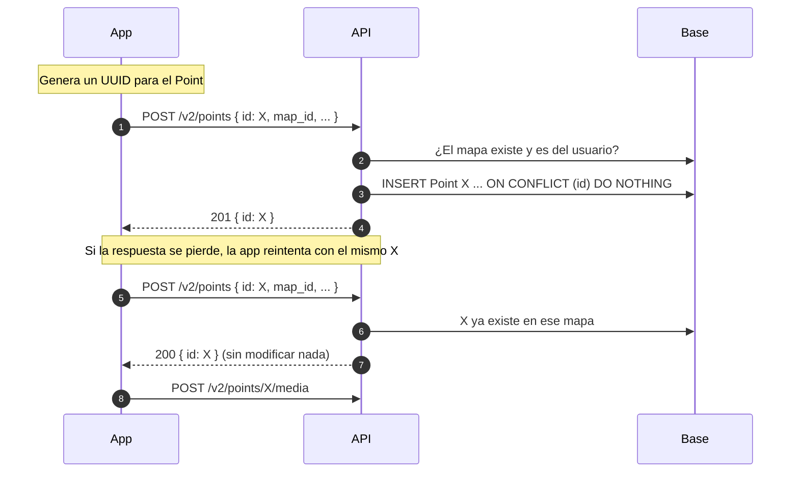

# Feature spec — Crear un Point (`POST /v2/points`)

## Propósito

Permitir que el dueño de un mapa cree un Point desde un cliente con conexión
inestable (`chatmap-app`), de forma que reintentar sea seguro y que el cliente
conozca el id del Point para subirle media con `POST /v2/points/{point_id}/media`.

## Alcance

**Dentro**

- Crear **un** Point por request, en un mapa del usuario autenticado, incluido
  su live map.
- Id del Point generado por el cliente, con reintentos idempotentes.
- Campos: coordenadas, hora y mensaje. `username` lo completa la API.

**Fuera / diferido**

- Contributors anónimos. Los especifica [map_contributions.md](map_contributions.md)
  y siguen bloqueados por su escalada.
- Media. Ya existe `POST /v2/points/{point_id}/media`.
- Tags.
- Editar, ocultar o borrar Points.
- Crear varios Points en un request.
- La cola offline de la app.
- Leer Points en v2.

## Comportamiento

### Flujo



### Orden de los chequeos

1. Sesión (`CurrentUser`) → 401.
2. Validación del body → 422.
3. Mapa existente y del usuario → 404.
4. Id: nuevo → 201; mismo mapa → 200; otro mapa → 409.

Un body inválido para un mapa ajeno responde 422, no 404.

### Casos y bordes

| Situación | Disparador | Resultado observable |
|---|---|---|
| Point nuevo | El id no existe y el mapa es del usuario | Se crea el Point. `201 { id }` |
| Reintento | El id ya existe en el mismo mapa | No se modifica nada, aunque el contenido del body sea distinto. `200 { id }` |
| Reintento de un Point oculto | El id existe en el mismo mapa y el dueño lo ocultó (`removed = true`) | `200 { id }`. Sigue oculto |
| Id de otro mapa | El id existe con otro `map_id`, del mismo dueño o de otro | `409`. No cambia nada |
| Intentos simultáneos | Dos requests con el mismo id llegan a la vez | Un solo Point. Uno recibe 201 y el otro 200. Lo garantiza la clave primaria (`INSERT ... ON CONFLICT`), no un SELECT previo |
| Mismo UUID escrito distinto | Mayúsculas, sin guiones u otra forma válida | Es el mismo id. Se guarda en forma canónica: minúsculas y con guiones |
| Id que no es UUID | Por ejemplo `1759850123000-0` | `422` |
| Mapa inexistente o ajeno | `map_id` que no existe o es de otro usuario | `404 "Map not found."`. No se distingue un caso del otro |
| Mapa borrado antes del reintento | El dueño borró el mapa y llega un reintento | `404`. Los Points se borraron en cascada con el mapa |
| Live map | `map_id` del live map del usuario | Se crea como en cualquier otro mapa. No hay restricción extra |
| Sin sesión o JWT inválido | Sin `Authorization` ni cookie `hanko`, o token vencido | `401`, lo responde `CurrentUser` |
| Falta un campo obligatorio o tiene otro tipo | | `422` |
| Coordenadas fuera de rango | `latitude` fuera de [-90, 90] o `longitude` fuera de [-180, 180] | `422` |
| `time` sin zona horaria | Por ejemplo `2026-10-07T12:15:23` | `422` |
| `time` en el futuro o muy viejo | El reloj del teléfono está mal | Se acepta tal cual (pregunta abierta 1) |
| Sin `message` | | Se guarda `null` |
| Campos desconocidos | El body trae `username`, `file`, `tags` u otro campo fuera del contrato | Se ignoran y el request sigue normalmente. `username` lo sigue completando la API |
| Usuario sin `username` en Hanko | | `username` queda `null`. No se deriva del email |

## Contrato

### Request

```
POST /v2/points
Authorization: Bearer <JWT de Hanko>   (o cookie hanko)
```

```json
{
  "id": "3f1c2b9e-8a4d-4c1e-9f6a-2d7b5e0c1a84",
  "map_id": "…",
  "latitude": -34.6037,
  "longitude": -58.3816,
  "time": "2026-10-07T12:15:23-03:00",
  "message": "Calle inundada"
}
```

| Campo | Obligatorio | Regla |
|---|---|---|
| `id` | Sí | Cualquier UUID válido |
| `map_id` | Sí | Mapa del usuario autenticado |
| `latitude` | Sí | Número en [-90, 90] |
| `longitude` | Sí | Número en [-180, 180] |
| `time` | Sí | ISO 8601 con zona horaria. Es la hora en que se tomó el Point |
| `message` | No | Texto |

### Respuestas

| Código | Cuándo | Body |
|---|---|---|
| 201 | Se creó el Point | `{ "id": "…" }` |
| 200 | El Point ya existía en ese mapa | `{ "id": "…" }` |
| 401 | Sin sesión o JWT inválido | Error de `CurrentUser` |
| 404 | El mapa no existe o no es del usuario | `"Map not found."` |
| 409 | El id pertenece a un Point de otro mapa | `"Point id already taken."` |
| 422 | Body inválido | Error de validación |
| 503 | Falla la base de datos | `"Point storage unavailable."` |

### Lo que se guarda

| Columna | Valor |
|---|---|
| `id` | El UUID del body, en forma canónica |
| `map_id` | El del body |
| `geom` | `POINT(longitude latitude)`, SRID 4326 |
| `time` | El `time` del body convertido a UTC. La columna no guarda zona |
| `message` | El del body, o `null` |
| `username` | `username` del usuario de Hanko, o `null` |
| `removed` | `false` |
| `file` | `null` |
| `tags` | `null` |

## Decisiones

1. **Solo el dueño del mapa puede crear.** Se autoriza con `CurrentUser` y
   `map.owner_id`, como media en v2. No depende de la escalada de
   [map_contributions.md](map_contributions.md), que ya prevé que el dueño siga
   este camino ("El dueño no es un Contributor"). *Descartado:* aceptar
   Contributors desde ahora. *A tener en cuenta:* `CurrentUser` lee el JWT de
   `Authorization: Bearer`, el mismo header donde esa spec pone el secreto del
   Contributor. Cómo convivan las dos credenciales es el punto 2 de su
   escalada.

2. **Ruta `POST /v2/points`, con `map_id` en el body.** Crear Points y subir
   media (`/v2/points/{point_id}/media`) quedan sobre el mismo recurso. En v2
   la autorización vive en el store, como en `MediaStore`, así que no hace
   falta el mapa en el path. *Descartado:* `POST /v2/maps/{map_id}/points`.

3. **Un Point por request.** La media se sube de a un Point y el flujo es
   crear y después subir. *Descartado:* crear varios en un request.

4. **El id del Point lo genera el cliente y es obligatorio.** Con mala señal,
   la respuesta de un request puede perderse después de que la API guardó el
   Point. La app solo puede reintentar sin duplicar si conoce el id antes de
   mandar el request. Es el patrón de ODK Collect con su `instanceID`. Se
   acepta cualquier UUID válido. Un id obligatorio deja un solo
   comportamiento: todo cliente queda protegido contra reintentos.
   *Descartado:*
   - *Id generado por la API:* un reintento crea un Point duplicado.
   - *Un id de la operación aparte (`Idempotency-Key`):* necesita guardar
     cada clave con el Point que creó, y en forma durable. Si la clave vence,
     una app que recupera la señal días después vuelve a duplicar. Además,
     crear es la única operación que lo necesita: editar y borrar ya apuntan a
     un id existente.

5. **Un reintento no modifica el Point y responde `200 { id }`.** El POST solo
   crea. Un reintento viejo que llega tarde no puede pisar una edición
   posterior ni volver visible un Point que el dueño ocultó. Si cambió el
   contenido, eso es una edición, que es otra operación. *Descartado:*
   - *Upsert:* mezcla crear con editar.
   - *409 si el contenido no coincide:* devuelve un error en un caso que salió
     bien, y el 409 ya significa otra cosa (decisión 6).

6. **409 si el id ya pertenece a un Point de otro mapa.** Le dice a la app que
   ese id no se puede usar y hace visible el bug que lo causó. *Descartado:*
   403 para esconder que el id existe. Los ids de Points ya aparecen en los
   exports y en el GeoJSON de los mapas públicos, así que esconderlo no
   protege nada.

7. **404 si el mapa no existe o no es del usuario.** Es lo que hace v1
   (`"Map not found"`). *Diferencia aceptada:* media en v2 responde 403 en la
   situación equivalente. *Descartado:* 403.

8. **Coordenadas como `latitude` y `longitude` con nombre.** Así no hay forma
   de invertirlas. *Descartado:* la geometría GeoJSON
   `{ "type": "Point", "coordinates": [lon, lat] }`, cuyo orden es una trampa
   conocida.

9. **`time` lo manda la app, con zona horaria, y se guarda en UTC.** Un Point
   cargado sin señal puede llegar días después, y el mapa tiene que mostrar
   cuándo se observó. Los exports ya asumen que la columna está en UTC
   (`main.py:1050`). No se usa el default de la columna: `datetime.now()` se
   evalúa una sola vez al importar el módulo y guarda la hora en que arrancó la
   API. *Descartado:* la hora en que la API recibe el request.

10. **`username` lo completa la API con el `username` de Hanko.** La app no lo
    puede falsificar. Es la misma dirección que toma la pregunta 6 de
    [map_contributions.md](map_contributions.md) para el apodo del
    Contributor. Si el usuario no tiene `username`, queda `null`. No se usa
    `display_name`, porque en ese caso toma la parte de antes de la `@` del
    email y la publicaría en los mapas públicos. *Descartado:* que la app lo
    mande como texto libre.

11. **Sin `tags` ni `file`.** Los tags se pueden agregar con
    `PUT /v1/point/{id}/tags/`, y sumarlos después como campo opcional no
    rompe a ningún cliente. La media va por su propio endpoint.

12. **La respuesta trae solo el id.** La app ya tiene el contenido que mandó,
    y el código dice si el Point se creó (201) o ya existía (200).
    *Consecuencia:* en un reintento la app no ve el contenido guardado ni se
    entera de que el Point está oculto. *Descartado:* devolver el Point
    completo.

13. **El live map se acepta como cualquier otro mapa.** Un live map es una
    campaña en curso, y el dueño puede sumar Points desde la app mientras otros
    mapean por WhatsApp. Los ids no pueden chocar (ver la nota sobre D-003).
    La restricción que tiene chatmap-ui para importar en mapas live es de la
    importación de exports, no del dominio.

14. **Solo se mapean los campos del contrato y los demás se ignoran.** El
    Point se arma con los campos conocidos del body. Lo que no está en el
    contrato no se guarda ni produce error. *Descartado:* responder 422 ante
    campos desconocidos.

## Nota para architect: alcance de D-003 (no bloquea)

[D-003](live_mode.md#d-003-point-id-determinism) dice que todo `Point.id` se
deriva del id de la entrada de Redis. Su justificación solo habla del stream,
y v1 ya crea Points con `uuid4()`. Esta feature agrega UUIDs generados por el
cliente. Se propone acotar el texto de D-003 a los Points del pipeline live.

Además, D-003 tiene un segundo motivo que el record no menciona. El bot
(`conversation_engine/tool.py:70`) toma como `point_id` el id del mensaje de
ubicación, por su cuenta y sin comunicarse con el stream.
`survey_responses.point_id` no tiene FK a `points`. Las respuestas de la
encuesta coinciden con el Point solo porque el bot y el stream derivan el id
del mismo mensaje.

Esta feature necesita que los ids del stream y los del cliente no puedan
coincidir nunca. Lo garantiza la exigencia de UUID: los ids del stream tienen
la forma `<epoch-ms>-0`. Si coincidieran, el upsert de `add_points`
(`ON CONFLICT (id) DO UPDATE`) movería el Point de la app al live map y pisaría
su ubicación.

## Preguntas abiertas

1. **Reloj del teléfono incorrecto.** Hoy se acepta cualquier `time`, incluso
   en el futuro o muy viejo. ¿Hace falta un rango válido?
2. **Borrado real de Points.** Hoy solo se pueden ocultar
   (`PUT /v1/point/{id}/remove/`). Si se agrega un borrado real, un reintento
   tardío volvería a crear el Point, porque para la API sería un id
   desconocido. Habría que guardar alguna marca de los ids borrados.
3. **Contributors.** Cuando se cierre la escalada de
   [map_contributions.md](map_contributions.md), definir cómo los acepta este
   endpoint: la misma ruta con una dependencia que pruebe las dos
   credenciales, otro header u otra ruta. El endpoint de media necesita el
   mismo cambio.
4. **Media de v2 en las lecturas de v1.** `map_response` (`main.py:441`) solo
   lee `Point.file` y no consulta la tabla `media`. Una media subida por v2
   no aparece al leer el mapa, así que en chatmap-ui el Point se vería sin
   foto. Queda fuera de esta feature.
