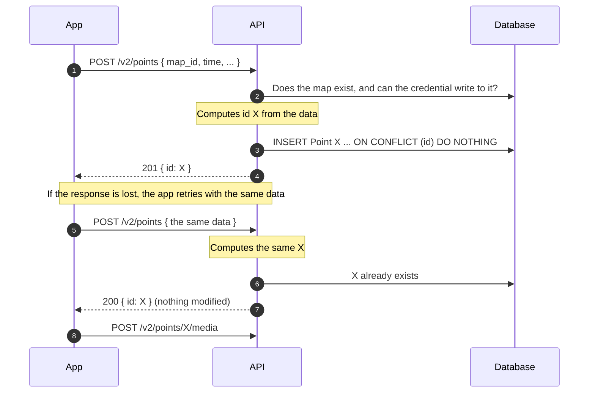

# Feature spec — Create a Point (`POST /v2/points`)

## Purpose

Let a map's owner, or a contributor to that map, create a Point from a client
with an unreliable connection (`chatmap-app`), so that retrying is safe and the
client knows the Point's id to upload media to it with
`POST /v2/points/{point_id}/media`.

Who can contribute and how they are authorized is defined in
[map_contributions.md](map_contributions.md). The app's send queue is in
[offline_contributions.md](offline_contributions.md).

## Scope

**In scope**

- Creating **one** Point per request, on a map of the authenticated user
  (including their live map) or on a map where the credential belongs to an
  active contributor.
- Point id computed by the server from the data, with idempotent retries.
- Fields: coordinates, capture time (required) and message. The API fills in
  `username`.

**Out of scope / deferred**

- Media. `POST /v2/points/{point_id}/media` already exists.
- Tags.
- Editing, hiding or deleting Points.
- Creating several Points in one request.
- The app's offline queue.
- Reading Points in v2 (the contributor's history is in
  [offline_contributions.md](offline_contributions.md)).

## Behavior

### Flow



### Who writes

| Credential | Who it is | Condition |
|---|---|---|
| Hanko session (`Authorization: Bearer` or `hanko` cookie) | The owner | The map is theirs |
| `Authorization: Contributor <secret>` | A contributor | Has an active Contributor on that map |

If the request carries `Authorization: Contributor`, that credential decides,
even if there is also a session.

### Order of checks

1. Some credential → 401. A malformed contributor secret is also 401.
2. Body validation → 422.
3. Map exists → 404. For the owner, also that it is theirs.
4. Contributor only: active Contributor on that map → 403.
5. Insert: new → 201; already existed with that data → 200.

An invalid body for someone else's map gets 422, not 404.

### Cases and edge cases

| Situation | Trigger | Observable result |
|---|---|---|
| New Point | The data matches no Point and the credential can write | The Point is created. `201 { id }` |
| Retry | The same data, from the same sender, for the same map | The server computes the same id. Nothing is modified. `200 { id }` |
| Retry of a hidden Point | The Point exists and the owner hid it (`removed = true`) | `200 { id }`. It stays hidden |
| Simultaneous attempts | Two requests with the same data arrive at the same time | A single Point. One gets 201 and the other 200. The primary key guarantees it (`INSERT ... ON CONFLICT`), not a prior SELECT |
| Two senders, same data | Two contributors send the same thing | Two different Points: the sender is part of the id computation |
| Same instant, another time zone | `12:00-03:00` and `15:00Z` | Same id: the time is normalized to UTC |
| Empty or missing message | `""` or no `message` | Same id in both cases |
| The body carries `id` | The app sends its own id | Ignored. The server computes the id |
| Map missing or someone else's | `map_id` that doesn't exist, or belongs to another user and the credential is a session | `404 "Map not found."`. The two cases can't be told apart |
| Map deleted before the retry | The owner deleted the map and a retry arrives | `404`. The Points and Contributors were deleted in cascade |
| Contributor without access | The secret isn't a Contributor of that map | `403` |
| Removed contributor | The Contributor has `removed_at` | `403`. Not inserted, even if the Point had arrived before |
| Time in the future | `time` later than now, for example with the phone's clock ahead | Accepted as is, just like an old time. The Point shows first in the history |
| Live map | `map_id` of the user's live map | Created as on any other map. No extra restriction |
| No credential | No `Authorization` or `hanko` cookie, or an expired token | `401` |
| Malformed contributor secret | Not 43 base64url characters | `401` |
| A required field is missing or has another type | | `422` |
| Coordinates out of range | `latitude` outside [-90, 90] or `longitude` outside [-180, 180] | `422` |
| `time` without a time zone | For example `2026-10-07T12:15:23` | `422` |
| Very old `time` | The phone's clock is wrong | Accepted as is |
| No `message` | | `null` is stored |
| Unknown fields | The body carries `username`, `file`, `tags` or another field outside the contract | Ignored, and the request proceeds normally |
| User without a `username` in Hanko | | `username` stays `null`. It is not derived from the email |

## Contract

### Request

```
POST /v2/points
Authorization: Bearer <Hanko JWT>   (or hanko cookie)
```

or, for a contributor:

```
POST /v2/points
Authorization: Contributor <secret>
```

```json
{
  "map_id": "…",
  "latitude": -34.6037,
  "longitude": -58.3816,
  "time": "2026-10-07T12:15:23-03:00",
  "message": "Flooded street"
}
```

| Field | Required | Rule |
|---|---|---|
| `map_id` | Yes | A map of the authenticated user, or a map where the secret belongs to an active contributor |
| `latitude` | Yes | Number in [-90, 90] |
| `longitude` | Yes | Number in [-180, 180] |
| `time` | Yes | ISO 8601 with time zone. The time the Point was taken |
| `message` | No | Text |

### Responses

| Code | When | Body |
|---|---|---|
| 201 | The Point was created | `{ "id": "…" }` |
| 200 | A Point with that data already existed | `{ "id": "…" }` |
| 401 | No credential, invalid JWT or malformed secret | Authentication error |
| 403 | Contributor not on that map, or removed | `"Not authorized."` |
| 404 | The map doesn't exist, or isn't the user's | `"Map not found."` |
| 422 | Invalid body | Validation error |
| 503 | The database fails | `"Point storage unavailable."` |

### The Point id

The server computes it as the SHA-256, in hexadecimal (64 characters), of this
data:

| Data | Detail |
|---|---|
| Sender | `owner:<user.id>` for the owner, `contributor:<contributor.id>` for a contributor |
| `map_id` | The one in the body |
| Capture time | The body's `time`, in UTC, with microseconds |
| Coordinates | `latitude` and `longitude` |
| Message | The one in the body. Empty and missing count the same |

The same data always gives the same id. The time is the one the app set when
capturing, not the time the server receives the request: if it were the
server's, a retry would give another id.

### What is stored

| Column | Value |
|---|---|
| `id` | The hash above |
| `map_id` | The one in the body |
| `geom` | `POINT(longitude latitude)`, SRID 4326 |
| `time` | The body's `time` converted to UTC. The column stores no time zone |
| `message` | The one in the body, or `null` |
| `username` | The Hanko user's `username`, or the contributor's nickname. Can be `null` |
| `contributor_id` | The Contributor's id, or `null` for the owner |
| `removed` | `false` |
| `file` | `null` |
| `tags` | `null` |

## Decisions

1. **The map's owner and active contributors can create.** The owner is
   authorized with the session and `map.owner_id`. The contributor, with
   `Authorization: Contributor <secret>` and an active Contributor on that map.
   It is the same route, with a dependency that accepts both credentials.
   *Before:* only the owner, pending the escalation in
   [map_contributions.md](map_contributions.md).

2. **Route `POST /v2/points`, with `map_id` in the body.** Creating Points and
   uploading media (`/v2/points/{point_id}/media`) sit on the same resource. In
   v2 authorization lives in the store, as in `MediaStore`, so the map isn't
   needed in the path. *Discarded:* `POST /v2/maps/{map_id}/points`.

3. **One Point per request.** Media is uploaded one Point at a time, and the
   flow is create, then upload. *Discarded:* creating several in one request.

4. **The server computes the id from the data.** With a bad signal, a
   request's response can be lost after the API saved the Point. A retry with
   the same data gives the same id, and the primary key rejects it. Details and
   discarded alternatives in Decision 6 of
   [offline_contributions.md](offline_contributions.md). *Before:* the app
   generated the id (the ODK Collect pattern with its `instanceID`).

5. **A retry doesn't modify the Point and responds `200 { id }`.** The POST
   only creates. An old retry that arrives late can't overwrite a later edit or
   make visible a Point the owner hid. Since the id comes from the data, a
   retry with different content isn't a retry: it is another Point.
   *Discarded:* upsert, which mixes creating with editing.

6. **No 409 for the id.** Before, the client chose the id and could collide
   with a Point on another map, which got a 409. Now the map is part of the id
   computation, so the collision can't happen.

7. **404 if the map doesn't exist or isn't the user's, 403 if the contributor
   can't write.** The 404 is what v1 does (`"Map not found"`). The 403 for the
   contributor is what media does in v2. A contributor on a map that doesn't
   exist gets 404.

8. **Coordinates as named `latitude` and `longitude`.** That way they can't be
   swapped. *Discarded:* the GeoJSON geometry
   `{ "type": "Point", "coordinates": [lon, lat] }`, whose order is a
   well-known trap.

9. **The app sends `time`, with a time zone, and it is stored in UTC.** A Point
   captured with no signal can arrive days later, and the map has to show when
   it was observed. Exports already assume the column is in UTC
   (`main.py:1050`). The column default isn't used: `datetime.now()` is
   evaluated only once, when the module is imported, and stores the time the
   API started. *Discarded:* the time the API receives the request.

10. **The API fills in `username`.** The app can't forge it. For the owner it
    is the Hanko `username`, or `null` if they don't have one. `display_name`
    isn't used, because in that case it takes the part of the email before the
    `@` and would publish it on public maps. For the contributor it is their
    nickname. *Discarded:* the app sending it as free text.

11. **No `tags` or `file`.** Tags can be added with
    `PUT /v1/point/{id}/tags/`, and adding them later as an optional field
    breaks no client. Media goes through its own endpoint.

12. **The response carries only the id.** The app already has the content it
    sent, and the code says whether the Point was created (201) or already
    existed (200). *Consequence:* on a retry the app doesn't see the stored
    content, nor learn that the Point is hidden. *Discarded:* returning the
    whole Point.

13. **The live map is accepted like any other map.** A live map is an ongoing
    campaign, and the owner can add Points from the app while others map over
    WhatsApp. The ids can't collide (see the note on D-003). The restriction
    chatmap-ui has on importing into live maps belongs to importing exports,
    not to the domain.

14. **Only the contract fields are mapped, and the rest are ignored.** The
    Point is built from the known fields of the body. Anything outside the
    contract isn't stored and doesn't produce an error. This includes an `id`
    sent by the app. *Discarded:* responding 422 to unknown fields.

15. **If there is both a contributor credential and a session, the
    contributor's decides.** It is the one the request declares explicitly,
    while the session cookie arrives on its own. A malformed secret is a 401
    and doesn't fall back to the session.

16. **A time in the future is accepted, just like an old one.** The only thing
    that changes is the history order: the Point shows first. It breaks neither
    pagination nor any read, and the owner can hide it. An old time is also
    accepted, because an offline queue can upload days later. *Discarded:*
    rejecting with 422 a contributor whose time is later than now plus 5
    minutes of tolerance, which was the previous decision. With the phone's
    clock ahead, the app marked valid captures as rejected and didn't retry
    them, even though the same request would have been accepted later. Besides,
    the owner never had that check.

## Note for architect: scope of D-003 (non-blocking)

[D-003](live_mode.md#d-003-point-id-determinism) says every `Point.id` is
derived from the Redis entry id. Its rationale only talks about the stream,
and v1 already creates Points with `uuid4()`. This feature adds ids computed by
the server from the data. The proposal is to narrow D-003's text to the Points
of the live pipeline.

D-003 also has a second reason the record doesn't mention. The bot
(`conversation_engine/tool.py:70`) takes the location message's id as
`point_id`, on its own and without talking to the stream.
`survey_responses.point_id` has no FK to `points`. The survey answers match the
Point only because the bot and the stream derive the id from the same message.

This feature needs the stream's ids and the ones computed here to never
collide. Their shape guarantees it: stream ids look like `<epoch-ms>-0`, and
this feature's are 64 hexadecimal characters. If they matched, the upsert in
`add_points` (`ON CONFLICT (id) DO UPDATE`) would move the app's Point to the
live map and overwrite its location.

## Open questions

1. **Resolved** (Decision 16): nobody has a future-time check, so the owner's
   clock doesn't need one either.
2. **Actually deleting Points.** Today they can only be hidden
   (`PUT /v1/point/{id}/remove/`). If real deletion is added, a late retry
   would create the Point again, because to the API it would be an unknown id.
   Some record of the deleted ids would have to be kept.
3. **v2 media in v1 reads.** `map_response` (`main.py:441`) only reads
   `Point.file` and doesn't query the `media` table. Media uploaded through v2
   doesn't appear when reading the map, so in chatmap-ui the Point would show
   without a photo. Out of scope for this feature.
