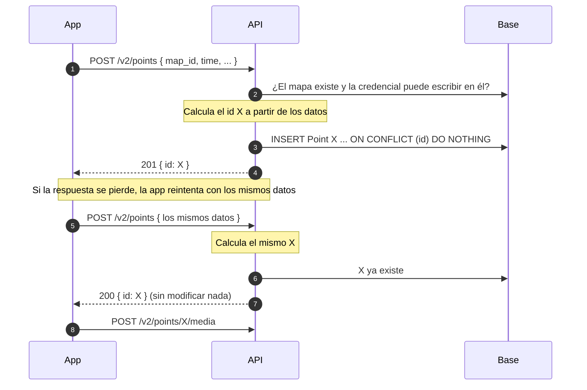

# Feature spec — Crear un Point (`POST /v2/points`)

## Propósito

Permitir que el dueño de un mapa, o un contribuyente de ese mapa, cree un Point
desde un cliente con conexión inestable (`chatmap-app`), de forma que reintentar
sea seguro y que el cliente conozca el id del Point para subirle media con
`POST /v2/points/{point_id}/media`.

Quién puede contribuir y cómo se autoriza lo define
[map_contributions.md](map_contributions.md). La cola de envío de la app, en
[offline_contributions.md](offline_contributions.md).

## Alcance

**Dentro**

- Crear **un** Point por request, en un mapa del usuario autenticado (incluido
  su live map) o en un mapa donde la credencial es de un contribuyente activo.
- Id del Point calculado por el servidor a partir de los datos, con reintentos
  idempotentes.
- Campos: coordenadas, hora de captura (obligatoria) y mensaje. `username` lo
  completa la API.

**Fuera / diferido**

- Media. Ya existe `POST /v2/points/{point_id}/media`.
- Tags.
- Editar, ocultar o borrar Points.
- Crear varios Points en un request.
- La cola offline de la app.
- Leer Points en v2 (el historial del contribuyente está en
  [offline_contributions.md](offline_contributions.md)).

## Comportamiento

### Flujo



### Quién escribe

| Credencial | Quién es | Condición |
|---|---|---|
| Sesión de Hanko (`Authorization: Bearer` o cookie `hanko`) | El dueño | El mapa es suyo |
| `Authorization: Contributor <secreto>` | Un contribuyente | Tiene un Contributor activo en ese mapa |

Si el pedido trae `Authorization: Contributor`, esa credencial decide, aunque
también haya una sesión.

### Orden de los chequeos

1. Alguna credencial → 401. Un secreto de contribuyente mal formado también es 401.
2. Validación del body → 422.
3. Mapa existente → 404. Para el dueño, además, que sea suyo.
4. Solo contribuyente: Contributor activo en ese mapa → 403.
5. Insertar: nuevo → 201; ya existía con esos datos → 200.

Un body inválido para un mapa ajeno responde 422, no 404.

### Casos y bordes

| Situación | Disparador | Resultado observable |
|---|---|---|
| Point nuevo | Los datos no coinciden con ningún Point y la credencial puede escribir | Se crea el Point. `201 { id }` |
| Reintento | Los mismos datos, del mismo remitente, para el mismo mapa | El servidor calcula el mismo id. No se modifica nada. `200 { id }` |
| Reintento de un Point oculto | El Point existe y el dueño lo ocultó (`removed = true`) | `200 { id }`. Sigue oculto |
| Intentos simultáneos | Dos requests con los mismos datos llegan a la vez | Un solo Point. Uno recibe 201 y el otro 200. Lo garantiza la clave primaria (`INSERT ... ON CONFLICT`), no un SELECT previo |
| Dos remitentes, mismos datos | Dos contribuyentes mandan lo mismo | Dos Points distintos: el remitente entra en el cálculo del id |
| Mismo instante, otra zona horaria | `12:00-03:00` y `15:00Z` | Mismo id: la hora se normaliza a UTC |
| Mensaje vacío o ausente | `""` o sin `message` | Mismo id en los dos casos |
| El body trae `id` | La app manda un id propio | Se ignora. El id lo calcula el servidor |
| Mapa inexistente o ajeno | `map_id` que no existe, o es de otro usuario y la credencial es una sesión | `404 "Map not found."`. No se distingue un caso del otro |
| Mapa borrado antes del reintento | El dueño borró el mapa y llega un reintento | `404`. Los Points y los Contributors se borraron en cascada |
| Contribuyente sin acceso | El secreto no es de un Contributor de ese mapa | `403` |
| Contribuyente quitado | El Contributor tiene `removed_at` | `403`. No se inserta, aunque el Point ya hubiera llegado antes |
| Hora en el futuro | `time` posterior a la actual, por ejemplo con el reloj del teléfono adelantado | Se acepta tal cual, igual que una hora vieja. El Point aparece primero en el historial |
| Live map | `map_id` del live map del usuario | Se crea como en cualquier otro mapa. No hay restricción extra |
| Sin credencial | Sin `Authorization` ni cookie `hanko`, o token vencido | `401` |
| Secreto de contribuyente mal formado | No son 43 caracteres de base64url | `401` |
| Falta un campo obligatorio o tiene otro tipo | | `422` |
| Coordenadas fuera de rango | `latitude` fuera de [-90, 90] o `longitude` fuera de [-180, 180] | `422` |
| `time` sin zona horaria | Por ejemplo `2026-10-07T12:15:23` | `422` |
| `time` muy viejo | El reloj del teléfono está mal | Se acepta tal cual |
| Sin `message` | | Se guarda `null` |
| Campos desconocidos | El body trae `username`, `file`, `tags` u otro campo fuera del contrato | Se ignoran y el request sigue normalmente |
| Usuario sin `username` en Hanko | | `username` queda `null`. No se deriva del email |

## Contrato

### Request

```
POST /v2/points
Authorization: Bearer <JWT de Hanko>   (o cookie hanko)
```

o, para un contribuyente:

```
POST /v2/points
Authorization: Contributor <secreto>
```

```json
{
  "map_id": "…",
  "latitude": -34.6037,
  "longitude": -58.3816,
  "time": "2026-10-07T12:15:23-03:00",
  "message": "Calle inundada"
}
```

| Campo | Obligatorio | Regla |
|---|---|---|
| `map_id` | Sí | Mapa del usuario autenticado, o mapa donde el secreto es de un contribuyente activo |
| `latitude` | Sí | Número en [-90, 90] |
| `longitude` | Sí | Número en [-180, 180] |
| `time` | Sí | ISO 8601 con zona horaria. Es la hora en que se tomó el Point |
| `message` | No | Texto |

### Respuestas

| Código | Cuándo | Body |
|---|---|---|
| 201 | Se creó el Point | `{ "id": "…" }` |
| 200 | Ya existía un Point con esos datos | `{ "id": "…" }` |
| 401 | Sin credencial, JWT inválido o secreto mal formado | Error de autenticación |
| 403 | Contribuyente que no es de ese mapa, o quitado | `"Not authorized."` |
| 404 | El mapa no existe, o no es del usuario | `"Map not found."` |
| 422 | Body inválido | Error de validación |
| 503 | Falla la base de datos | `"Point storage unavailable."` |

### El id del Point

El servidor lo calcula como el SHA-256, en hexadecimal (64 caracteres), de estos
datos:

| Dato | Detalle |
|---|---|
| Remitente | `owner:<user.id>` para el dueño, `contributor:<contributor.id>` para un contribuyente |
| `map_id` | El del body |
| Hora de captura | El `time` del body, en UTC, con microsegundos |
| Coordenadas | `latitude` y `longitude` |
| Mensaje | El del body. Vacío y ausente cuentan igual |

Los mismos datos dan siempre el mismo id. La hora es la que fijó la app al
capturar, no la hora en que el servidor recibe el pedido: si fuera la del
servidor, un reintento daría otro id.

### Lo que se guarda

| Columna | Valor |
|---|---|
| `id` | El hash de arriba |
| `map_id` | El del body |
| `geom` | `POINT(longitude latitude)`, SRID 4326 |
| `time` | El `time` del body convertido a UTC. La columna no guarda zona |
| `message` | El del body, o `null` |
| `username` | El `username` del usuario de Hanko, o el apodo del contribuyente. Puede ser `null` |
| `contributor_id` | El id del Contributor, o `null` para el dueño |
| `removed` | `false` |
| `file` | `null` |
| `tags` | `null` |

## Decisiones

1. **Pueden crear el dueño del mapa y los contribuyentes activos.** El dueño se
   autoriza con la sesión y `map.owner_id`. El contribuyente, con
   `Authorization: Contributor <secreto>` y un Contributor activo en ese mapa.
   Es la misma ruta, con una dependencia que acepta las dos credenciales. *Antes:*
   solo el dueño, a la espera de la escalada de
   [map_contributions.md](map_contributions.md).

2. **Ruta `POST /v2/points`, con `map_id` en el body.** Crear Points y subir
   media (`/v2/points/{point_id}/media`) quedan sobre el mismo recurso. En v2
   la autorización vive en el store, como en `MediaStore`, así que no hace
   falta el mapa en el path. *Descartado:* `POST /v2/maps/{map_id}/points`.

3. **Un Point por request.** La media se sube de a un Point y el flujo es
   crear y después subir. *Descartado:* crear varios en un request.

4. **El id lo calcula el servidor a partir de los datos.** Con mala señal, la
   respuesta de un request puede perderse después de que la API guardó el
   Point. Un reintento con los mismos datos da el mismo id, y la clave primaria
   lo rechaza. Detalle y alternativas descartadas en la Decisión 6 de
   [offline_contributions.md](offline_contributions.md). *Antes:* el id lo
   generaba la app (el patrón de ODK Collect con su `instanceID`).

5. **Un reintento no modifica el Point y responde `200 { id }`.** El POST solo
   crea. Un reintento viejo que llega tarde no puede pisar una edición
   posterior ni volver visible un Point que el dueño ocultó. Como el id sale de
   los datos, un reintento con otro contenido no es un reintento: es otro Point.
   *Descartado:* upsert, que mezcla crear con editar.

6. **Sin 409 por id.** Antes el cliente elegía el id y podía chocar con un Point
   de otro mapa, y eso respondía 409. Ahora el mapa entra en el cálculo del id,
   así que el choque no existe.

7. **404 si el mapa no existe o no es del usuario, 403 si el contribuyente no
   puede escribir.** El 404 es lo que hace v1 (`"Map not found"`). El 403 para
   el contribuyente es lo que hace media en v2. Un contribuyente sobre un mapa
   que no existe recibe 404.

8. **Coordenadas como `latitude` y `longitude` con nombre.** Así no hay forma
   de invertirlas. *Descartado:* la geometría GeoJSON
   `{ "type": "Point", "coordinates": [lon, lat] }`, cuyo orden es una trampa
   conocida.

9. **`time` lo manda la app, con zona horaria, y se guarda en UTC.** Un Point
   cargado sin señal puede llegar días después, y el mapa tiene que mostrar
   cuándo se observó. Los exports ya asumen que la columna está en UTC
   (`main.py:1050`). No se usa el default de la columna: `datetime.now()` se
   evalúa una sola vez al importar el módulo y guarda la hora en que arrancó la
   API. *Descartado:* la hora en que la API recibe el request.

10. **`username` lo completa la API.** La app no lo puede falsificar. Para el
    dueño es el `username` de Hanko, o `null` si no tiene. No se usa
    `display_name`, porque en ese caso toma la parte de antes de la `@` del
    email y la publicaría en los mapas públicos. Para el contribuyente es su
    apodo. *Descartado:* que la app lo mande como texto libre.

11. **Sin `tags` ni `file`.** Los tags se pueden agregar con
    `PUT /v1/point/{id}/tags/`, y sumarlos después como campo opcional no
    rompe a ningún cliente. La media va por su propio endpoint.

12. **La respuesta trae solo el id.** La app ya tiene el contenido que mandó,
    y el código dice si el Point se creó (201) o ya existía (200).
    *Consecuencia:* en un reintento la app no ve el contenido guardado ni se
    entera de que el Point está oculto. *Descartado:* devolver el Point
    completo.

13. **El live map se acepta como cualquier otro mapa.** Un live map es una
    campaña en curso, y el dueño puede sumar Points desde la app mientras otros
    mapean por WhatsApp. Los ids no pueden chocar (ver la nota sobre D-003).
    La restricción que tiene chatmap-ui para importar en mapas live es de la
    importación de exports, no del dominio.

14. **Solo se mapean los campos del contrato y los demás se ignoran.** El
    Point se arma con los campos conocidos del body. Lo que no está en el
    contrato no se guarda ni produce error. Incluye un `id` que mande la app.
    *Descartado:* responder 422 ante campos desconocidos.

15. **Si hay una credencial de contribuyente y una sesión, decide la del
    contribuyente.** Es la que el pedido declara de forma explícita, mientras
    que la cookie de sesión llega sola. El secreto mal formado es 401 y no
    cae a la sesión.

16. **Una hora en el futuro se acepta, igual que una vieja.** Lo único que
    cambia es el orden del historial: el Point aparece primero. No rompe la
    paginación ni ninguna lectura, y el dueño puede ocultarlo. Una hora vieja
    también se acepta, porque una cola offline puede subir días después.
    *Descartado:* rechazar con 422 a un contribuyente con una hora posterior a
    la actual más 5 minutos de tolerancia, que era la decisión anterior. Con el
    reloj del teléfono adelantado, la app marcaba como rechazadas capturas
    válidas y no las reintentaba, aunque el mismo pedido se habría aceptado más
    tarde. Además, el dueño nunca tuvo ese chequeo.

## Nota para architect: alcance de D-003 (no bloquea)

[D-003](live_mode.md#d-003-point-id-determinism) dice que todo `Point.id` se
deriva del id de la entrada de Redis. Su justificación solo habla del stream,
y v1 ya crea Points con `uuid4()`. Esta feature agrega ids calculados por el
servidor a partir de los datos. Se propone acotar el texto de D-003 a los
Points del pipeline live.

Además, D-003 tiene un segundo motivo que el record no menciona. El bot
(`conversation_engine/tool.py:70`) toma como `point_id` el id del mensaje de
ubicación, por su cuenta y sin comunicarse con el stream.
`survey_responses.point_id` no tiene FK a `points`. Las respuestas de la
encuesta coinciden con el Point solo porque el bot y el stream derivan el id
del mismo mensaje.

Esta feature necesita que los ids del stream y los calculados acá no puedan
coincidir nunca. Lo garantiza la forma: los ids del stream tienen la forma
`<epoch-ms>-0`, y los de esta feature son 64 caracteres hexadecimales. Si
coincidieran, el upsert de `add_points` (`ON CONFLICT (id) DO UPDATE`) movería
el Point de la app al live map y pisaría su ubicación.

## Preguntas abiertas

1. **Resuelta** (Decisión 16): nadie tiene chequeo de hora futura, así que el
   reloj del dueño tampoco lo necesita.
2. **Borrado real de Points.** Hoy solo se pueden ocultar
   (`PUT /v1/point/{id}/remove/`). Si se agrega un borrado real, un reintento
   tardío volvería a crear el Point, porque para la API sería un id
   desconocido. Habría que guardar alguna marca de los ids borrados.
3. **Media de v2 en las lecturas de v1.** `map_response` (`main.py:441`) solo
   lee `Point.file` y no consulta la tabla `media`. Una media subida por v2
   no aparece al leer el mapa, así que en chatmap-ui el Point se vería sin
   foto. Queda fuera de esta feature.
