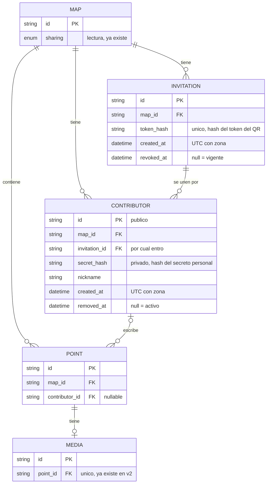
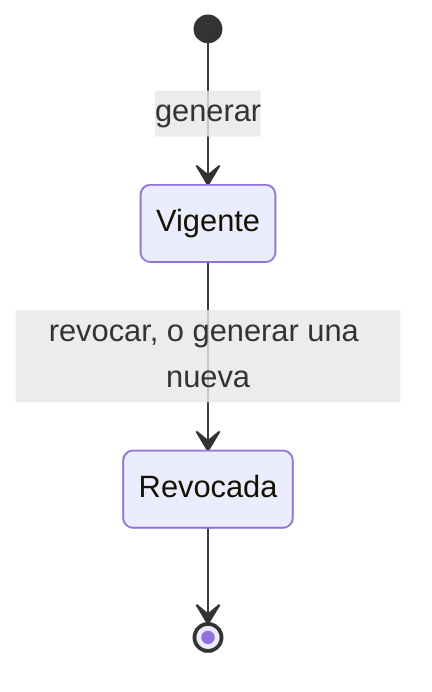
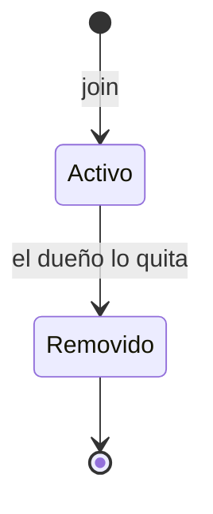
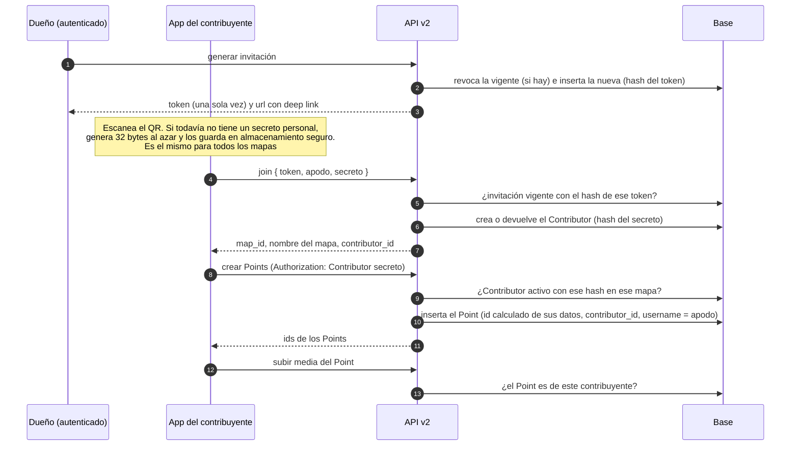

# Feature spec — Contribuciones desde la app

`chatmap-app` (Expo / React Native) permite que una persona se una a un mapa
con una invitación y agregue Points y media, con conexión o sin ella. Este
documento cubre la **primera entrega**: cómo el dueño invita, cómo una persona
se convierte en contribuyente y cómo se autoriza lo que escribe. La cola
offline y el envío ordenado de Points se especifican en
[offline_contributions.md](offline_contributions.md).

**Vocabulario de versiones.** "API v1" y "API v2" son las rutas `/v1` y `/v2`.
"Primera entrega" es el primer alcance de esta feature. Son cosas distintas.

**Premisa.** La app se conecta a **un solo servidor**, fijado al compilarla.
Quien despliegue una instancia propia necesita su propia compilación de la app.
Por eso el QR no necesita llevar la dirección del servidor.

## Decisiones de arquitectura (resueltas en esta spec)

Estas dos reglas cruzan toda la API y no existían en el decision record
([live_mode.md](live_mode.md), D-001 a D-010). Se resolvieron acá y **viven en
esta spec**. Otras specs que las necesiten pueden enlazarlas desde este
documento.

**A1. La API acepta dos tipos de quien escribe.** Hoy autoriza escrituras solo
con `CurrentUser`: valida un JWT emitido por Hanko (`hotosm_auth_fastapi`) y
compara `map.owner_id == user.id`. Pasa a aceptar también al **contribuyente**,
identificado por un secreto que la propia API registra y verifica. No es un
puente hasta tener Hanko: contribuir sin cuenta es una función permanente. El
secreto de contribuyente solo puede hacer lo que se declara en
[Contrato](#contrato): unirse, crear Points y subir media a **sus** Points.
Nunca puede alcanzar operaciones del dueño.

**A2. Convivencia con `CurrentUser`.**

- Todo el código nuevo vive en **API v2** (`api/v2`). API v1 no se toca.
- **Ninguna ruta acepta contribuyentes salvo que lo declare.** Por defecto una
  ruta acepta solo al dueño.
- El secreto viaja en `Authorization: Contributor <secreto>`, un esquema propio
  que se distingue sin adivinar del `Bearer` del JWT de Hanko. En `join` va en
  el cuerpo, porque todavía no hay un secreto registrado.
- Si un pedido trae las dos credenciales, se usa solo el secreto. La regla se
  aplica una vez, al leer las credenciales, y vale para todos los endpoints,
  también para leer media.
- El rol de quien llama en un mapa (dueño o contribuidor) se resuelve en una
  dependencia de la ruta, que responde 401, 403 o 404 si no tiene ninguno. El
  store recibe el rol y nunca las credenciales. Una única función,
  `role_in_map`, decide el rol (ver [Coexistencia de credenciales](#coexistencia-de-credenciales)).

## Propósito

Permitir que el dueño de un mapa invite, con un QR, a personas que usan la app a
agregar Points y media a su mapa sin necesitar una cuenta. Iniciar sesión es
opcional.

## Alcance

**Dentro**

- El eje de permiso de **escritura** de un mapa, separado del de lectura.
- La entidad `Invitation` (el QR): generarla, verla, revocarla.
- La entidad `Contributor` (la persona que se une): registrarla, listarla,
  quitarla.
- Autorizar a un contribuyente para unirse, crear Points y subir media a sus
  propios Points.
- Atribución de cada Point a su contribuyente.
- Consultar quién entró por una invitación en un rango de fechas.
- Cómo conviven el contribuyente anónimo (permanente) y el autenticado con
  Hanko.

**Fuera / diferido**

- **Pausar un mapa** o dejarlo "cerrado": no existe en la primera entrega. El
  único freno inmediato es quitar a un contribuyente.
- **Expulsión en bloque** (por ejemplo, quitar a todos los que entraron por una
  invitación). El modelo ya lo permite consultar, ver
  [Decisiones](#decisiones), 15.
- **Bloqueo de un dispositivo en todos los mapas, también en los nuevos.** Ya se
  puede reconocer al mismo dispositivo por su `secret_hash`. Falta guardar el
  bloqueo aparte para que valga en mapas donde todavía no entró.
- **Vencimiento del contribuyente** y de la invitación.
- **Rate limiting y abuso:** `max_uses`, topes por mapa, tope de tamaño de
  media. Deben cerrarse antes de exponer `join` y la escritura fuera de
  desarrollo (ver pregunta 6).
- **Lectura para contribuyentes** en mapas privados.
- Login de contribuyentes con Hanko y contraseña en la invitación. Solo se
  deja el lugar.
- Cola offline y reintentos: ver [offline_contributions.md](offline_contributions.md).
- Moderación (Points pendientes de aprobación).
- Filtro del modo live por remitente de WhatsApp (otra feature).
- Pantallas de la app, incluida la alerta que recomienda iniciar sesión.

## Vocabulario: "público" ya existe y significa otra cosa

`Map.sharing` (`PRIVATE` / `PUBLIC`, `db.py`) controla solo la **lectura**. Esta
feature **no lo modifica**.

| Eje | Pregunta | Dónde vive |
|---|---|---|
| Lectura | ¿Quién puede ver el mapa? | `Map.sharing` (ya existe) |
| Escritura | ¿Quién puede agregar Points desde la app? | `Invitation` y `Contributor` (nuevos) |

Los dos son independientes. En un mapa **privado**, solo lo ve el dueño, aunque
tenga contribuyentes.

## Modelo

- `Point.contributor_id` es `null` para los Points del dueño, del bot de
  WhatsApp y de importaciones.
- **Una sola invitación vigente por mapa**, garantizada por un índice único
  parcial: `UNIQUE (map_id) WHERE revoked_at IS NULL`.
- `UNIQUE (map_id, secret_hash)` en `contributors`, y un índice por
  `(invitation_id, created_at)` y otro por `secret_hash`. El mismo
  `secret_hash` aparece en una fila por cada mapa al que se unió esa persona.
- Las claves foráneas hacia `maps` llevan `ON DELETE CASCADE`, para que
  `DELETE /v1/map/{id}` siga funcionando sin tocar API v1.
  `contributors.invitation_id` también cae en cascada, para que borrar un mapa
  no dependa del orden en que la base borra sus filas.
- Las fechas de las tablas nuevas son **UTC con zona**. El resto del código
  guarda hora local sin zona, y no se modifica.

**Reservado, no se crea ahora:** `invitations.password_hash`,
`invitations.requires_login`, `invitations.expires_at`, `contributors.user_id`
y `contributors.expires_at`.

## Comportamiento

### Estados

| Entidad | Estados | Cómo se calcula |
|---|---|---|
| Invitación | **Vigente** o **revocada** | `revoked_at IS NULL` |
| Contributor | **Activo** o **removido** | `removed_at IS NULL` |

- La invitación vigente controla **quién entra** (`join`).
- Un Contributor activo controla **quién escribe**.
- **No hay un estado "abierto/cerrado" del mapa.** Revocar la invitación no
  afecta a quienes ya entraron.

### Flujo completo

### Casos y bordes

| Situación | Disparador | Resultado observable |
|---|---|---|
| Generar sin invitación vigente | El dueño pide generar | Se crea una invitación vigente. Se devuelve el token **una sola vez** y la `url` |
| Generar con una invitación vigente | El dueño pide generar | En una sola operación: la vigente pasa a `revoked_at = ahora` y se crea la nueva. Los contribuyentes no se ven afectados |
| Ver la invitación vigente | El dueño la consulta | Se devuelven sus datos (`id`, `created_at`, cuántos entraron), **nunca el token**. Si no hay vigente, no devuelve ninguna |
| Revocar | El dueño pide revocar | `revoked_at = ahora`. Nadie nuevo entra. Los contribuyentes siguen escribiendo |
| Revocar sin invitación vigente | El dueño pide revocar | Sin cambios y sin error |
| Generar, ver o revocar sin ser el dueño | Usuario que no es `owner_id`, o sin sesión | Se rechaza, con la convención de `PUT /map/{id}/share/` |
| `join` válido | Token de la invitación vigente, secreto bien formado, apodo | Se crea un Contributor activo (con `invitation_id` y `created_at`). Responde **201** con `contributor_id`, `map_id` y el nombre del mapa |
| `join` repetido | El mismo secreto en el mismo mapa, con la invitación vigente | **No hace nada.** Responde **200** (en lugar de 201) con el mismo Contributor, y esa es la marca para que la app muestre un aviso. No cambia el apodo, el `invitation_id` ni el `created_at` |
| `join` con invitación revocada o inexistente | Token que no corresponde a una invitación vigente | Responde **404** y **no se crea ninguna fila**. No se distingue "revocada" de "inexistente". Vale también para quien ya era contribuyente: no puede volver a unirse con ese QR, pero sigue pudiendo escribir |
| `join` con secreto mal formado | Largo distinto de 43 caracteres o caracteres fuera de base64url | Responde **422** y no se crea nada |
| `join` con el secreto de un Contributor removido | El secreto ya tiene `removed_at` en ese mapa | Responde **403**. Es un bloqueo, y es distinto del 404 para que la app pueda decirle a la persona que fue quitada |
| Mismo teléfono, otro mapa | La app se une a dos mapas | El mismo secreto y dos Contributors, uno por mapa. Cada uno tiene su propio estado: quitarlo de un mapa no afecta al otro. El servidor puede reconocer que comparten `secret_hash` |
| Escritura válida | Secreto de un Contributor activo del mapa | Se crea el Point con `contributor_id` |
| Reintento de un Point | Los mismos datos del mismo contribuyente | El servidor calcula el mismo id y devuelve el Point existente (200). No se modifica |
| Contributor removido escribe | `removed_at` no es nulo | Se rechaza |
| Quitar a un contribuyente | El dueño lo quita | `removed_at = ahora`. Sus Points **no se borran ni se modifican**. Ocultarlos es tarea del front (pregunta 2) |
| Secreto que no existe | Hash sin fila | Se rechaza |
| Contributor de otro mapa | El `map_id` pedido no es el suyo | Se responde como "mapa no encontrado" |
| Subir media a un Point propio | El Point tiene su `contributor_id` | Se adjunta |
| Subir media a un Point ajeno | Point del dueño, del bot o de otro contribuyente | Se rechaza |
| Contribuyente lee un mapa privado | Cualquier lectura | Se rechaza: en un mapa privado solo lee el dueño |
| Dueño escribe | `CurrentUser` con `owner_id` | Sin cambios. El dueño no es un Contributor |
| Se borra el mapa | El dueño elimina el mapa completo | Se borran en cascada sus invitaciones y contribuyentes. Es lo único que borra un Contributor: de a uno, solo se los marca como removidos |
| Se pierde el dispositivo | Cambiar de teléfono, o reinstalar la app (en Android) | Se genera otro secreto, y la persona es una identidad nueva en **todos** sus mapas: un Contributor nuevo por cada uno al que vuelva a unirse. Los anteriores quedan hasta que el dueño los quite. En iOS, reinstalar puede conservar el secreto, sin garantía |

## Contrato

**Nombres de ruta provisorios**, salvo la de media, que ya existe.

| Operación | Quién | Entrada | Efecto observable |
|---|---|---|---|
| Generar invitación (`POST /v2/maps/{map_id}/invitations`) | Dueño (`CurrentUser`) | `map_id` | Revoca la vigente, crea una nueva y devuelve `{ id, token, url, created_at }`. El token solo viaja en esta respuesta |
| Ver invitación vigente | Dueño | `map_id` | Datos de la invitación, sin el token |
| Revocar invitación | Dueño | `map_id` | `revoked_at = ahora` |
| Listar contribuyentes | Dueño | `map_id`, filtros opcionales `invitation_id`, `desde` y `hasta` (sobre `created_at`) | Apodo, `created_at`, `invitation_id`, `removed_at` y cantidad de Points |
| Quitar contribuyente | Dueño | `contributor_id` | `removed_at = ahora`. Permanente |
| Unirse (`POST /v2/invitations/join`) | Sin sesión: lo autoriza el token | `token`, `nickname`, `secret` | Responde **201** si crea el Contributor y **200** si ya existía. Devuelve `{ contributor_id, map_id, map_name }`. Errores: 404 invitación inválida, 403 contribuyente removido, 422 pedido mal formado |
| Crear Point (`POST /v2/points`, se amplía para aceptar contribuyentes) | Dueño o contribuyente | `Authorization: Contributor <secreto>` y el Point, sin `id`, con la hora de captura obligatoria | Responde 201 con el id que calcula el servidor a partir de los datos, o 200 con el mismo id si ya existía un Point con esos datos. Errores: 401 sin credencial o con un secreto mal formado, 403 contribuyente sin acceso o quitado, 404 mapa inexistente, 422 pedido inválido. Si trae `Authorization: Contributor`, esa credencial decide aunque haya sesión. Ver [create_point.md](create_point.md) y [offline_contributions.md](offline_contributions.md) |
| Subir media | Contribuyente o dueño | `POST /v2/points/{point_id}/media`, con el archivo y `captured_at` | Adjunta si el Point es suyo. Esta ruta existente pasa a declarar que acepta contribuyentes. `captured_at` es obligatorio: la hora en que el usuario adjuntó la media en la app, con zona horaria. Se valida igual que el `time` del Point: sin zona responde 422, y una hora futura se acepta. El servidor la guarda en UTC y nunca usa la hora en que recibió el archivo. Las medias subidas antes de este campo quedan sin hora (`null`) |

**El QR** lleva un link con el esquema propio `hot-chatmap://`, que arma el
servidor (el campo `url`). Contiene **solo el token**: la app ya sabe a qué
servidor hablar, y el token resuelve a qué mapa corresponde. El `map_id` le
llega a la app en la respuesta del `join`. El formato es
`hot-chatmap://join?token=<token>`.

**Point del contribuyente: qué acepta el servidor**

| Campo | ¿Lo manda la app? | Qué hace el servidor |
|---|---|---|
| Coordenadas | Sí | Valida los rangos |
| `message` | Sí | Lo guarda como viene |
| `time` (captura) | Sí | Lo acepta tal cual, sea vieja o futura. Sin zona horaria responde 422 |
| Id | No | Lo calcula el servidor a partir del remitente, el mapa, la hora de captura, las coordenadas y el mensaje |
| `username` | No | Lo completa con el apodo del Contributor |
| `file` | No | La media va por la ruta de media, después de crear el Point |
| `tags` | No | Quedan para el dueño |
| `removed` | No | Siempre `false` |

**Secretos.** Hay dos, con necesidades distintas:

| Secreto | Quién lo genera | Cuántos hay | Se guarda como | Para qué sirve |
|---|---|---|---|---|
| Token de la invitación | La API | Uno por invitación, compartido por todos los que escanean | `token_hash`. **Se muestra una sola vez** | Probar "el dueño me invitó", solo al unirse |
| Secreto personal | La app, 32 bytes al azar | **Uno por instalación**, el mismo para todos los mapas | `secret_hash` | Probar "soy este contribuyente", en cada escritura |

Los hashes son SHA-256 sin sal: con 32 bytes al azar no hace falta más. El `id`
público del Contributor y su secreto son dos valores distintos, porque
`Point.contributor_id` puede aparecer en exports y GeoJSON.

**Formato del secreto personal.** Son 32 bytes al azar escritos en **base64url
sin relleno**: 43 caracteres de `A-Z`, `a-z`, `0-9`, `-` y `_`. El servidor
rechaza cualquier otra cosa, porque es lo que garantiza que el secreto tenga la
fuerza que dice esta spec, y calcula el hash del texto tal como llega. Es el
mismo formato que el token de la invitación.

**Pedido del `join`: qué acepta el servidor**

| Campo | Regla |
|---|---|
| `token` | Texto no vacío. Se compara por su hash con las invitaciones vigentes |
| `nickname` | Se le quitan los espacios de los extremos y no puede quedar vacío. Todavía no tiene tope de largo (ver pregunta 6) |
| `secret` | El formato de arriba |

## Decisiones

1. **Eje de escritura separado de `sharing`.** Mezclarlos ataría "el mundo
   puede ver mi mapa" con "el mundo puede escribir en él", y al migrar los
   mapas `PUBLIC` existentes se volverían escribibles. *Descartado:* reusar
   `sharing` con otro valor.
2. **La invitación controla quién entra, el Contributor activo controla quién
   escribe, y no hay estado "abierto/cerrado" ni pausa.** *Descartado:* un flag
   en `Map`, y derivar "abierto" de las invitaciones y los contribuyentes, que
   obligaba a quitar a todos al cerrar. *Costo aceptado:* no hay un freno
   general, y el único inmediato es quitar de a uno. La pausa queda fuera de
   alcance.
3. **`Invitation` y `Contributor` son entidades separadas.** El token del QR
   circula por pantallas y chats, y se filtra fácil. El secreto personal vive
   solo en el teléfono. Separarlos permite quitar a una persona sin invalidar a
   las demás y saber quién escribió cada Point. *Descartado:* un token
   compartido que escriba directo (no se puede quitar a una sola persona ni
   atribuir) y un link por persona (no sirve para invitar a varias con un QR).
4. **El secreto personal lo genera la app, uno por instalación y el mismo para
   todos los mapas, y la API guarda su hash.** Así el `join` es idempotente y la
   API no emite credenciales. Como la app se conecta a un solo servidor, un QR no
   puede hacer que entregue su secreto a otro servidor. *Consecuencias:* un
   mismo `secret_hash` aparece en una fila por mapa, lo que permite reconocer al
   mismo dispositivo en varios mapas (para bloquearlo donde ya está, o para unir
   su historial al iniciar sesión) sin una tabla de usuarios. Un secreto
   filtrado afecta a todos los mapas de esa persona. *Descartado:*
   - *MAC del dispositivo:* Android la oculta desde la versión 6, iOS nunca la
     expone, y un identificador no es un secreto.
   - *Token emitido por la API:* rescanear crearía otro Contributor.
   - *Sin ninguna validación:* el `map_id` no es secreto (aparece en URLs y en
     el listado de mapas públicos).
   - *Un secreto por mapa:* se pensó contra un servidor falso, que no es posible
     si la app habla con un solo servidor. Costaba no poder reconocer al mismo
     dispositivo entre mapas.
5. **Los tokens de Hanko no se pueden delegar.** Hanko no ofrece API keys ni
   tokens delegados. Su Admin API puede crear una sesión para un `user_id`, pero
   emite un JWT **como ese usuario**, sin vencimiento propio por token y con la
   API key de administración. Haría pasar a los contribuyentes por el dueño.
   *Consecuencia:* quien entra con cuenta lo hace con su propio JWT, y el
   Contributor se enlaza con `user_id`.
6. **El contribuyente anónimo es permanente, no un puente hacia Hanko.** El
   secreto propio y el JWT de Hanko coexisten sin fecha de retiro, así que no
   hay ventana de transición. *Descartado:* tratar el secreto como credencial
   transitoria. Una única función, `role_in_map`, decide si quien llama es
   dueño o contribuidor de un mapa. La usan las dependencias de las rutas y la
   lectura de media, y los stores reciben el rol ya resuelto. *Descartado:* que
   cada store decida el rol a partir de las credenciales, porque repartía la
   regla de qué credencial gana y la elección del error entre varios archivos.
7. **Contributors en tabla y no en un array de `Map`.** Cada uno tiene apodo,
   fechas, `removed_at` y `secret_hash`. Buscar por secreto, indexar y
   garantizar unicidad con un array sería mucho más incómodo.
8. **El apodo es autodeclarado.** No es una identidad verificada. La identidad
   real llega con `user_id`.
9. **Perder el dispositivo pierde la identidad anónima, y se acepta.** La
   persona aparece como otro Contributor en cada mapa al que vuelva a unirse, y
   sus Points anteriores quedan atribuidos a los viejos. El secreto se guarda
   con `expo-secure-store`: en Android no sobrevive a reinstalar la app, y en
   iOS vive en el Keychain, que según la documentación de Expo puede conservarse
   tras desinstalar, aunque no está garantizado, así que no hay que depender de
   eso. *Descartado:* un código de recuperación, porque agrega un segundo secreto
   que también se puede perder. *Mitigación:* la app mostrará una alerta que
   recomienda iniciar sesión para no perder las contribuciones.
10. **El token de la invitación se guarda como hash y se muestra una sola vez.
    Generar uno nuevo revoca el anterior.** La base necesita reconocer y
    revocar la invitación, no conservar el token: con el hash, quien lea la
    base no puede unirse a ningún mapa. Como hay a lo sumo una vigente y la UI
    siempre puede mostrar sus datos (sin el token), no existen invitaciones
    válidas e invisibles. *Descartado:* guardarlo en claro; un token recuperable
    calculado con una clave del servidor; varias vigentes a la vez. *Costo
    aceptado:* un QR entregado a alguien que todavía no escaneó deja de servir
    al regenerar. La UI debe avisarlo y ofrecer descargar el QR al crearlo.
11. **Campos del Point del contribuyente** según la tabla del
    [Contrato](#contrato). `username` lo completa el servidor, para que nadie
    firme un Point como otra persona.
12. **Reemplazada por la Decisión 6 de
    [offline_contributions.md](offline_contributions.md).** Antes decía que el id
    del Point se derivaba con `uuid5(contributor.id, client_id)`, con un
    `client_id` que mandaba la app. Ahora el servidor calcula el id solo a
    partir de los datos del Point, sin nada que mande la app. Sigue valiendo que
    no se reutiliza `add_points` de API v1, que hace `ON CONFLICT DO UPDATE` y
    pisaría datos.
13. **El QR es un link con el esquema propio y único `hot-chatmap://`, armado
    por el servidor.** El escáner de la app lo lee directamente, y el esquema
    permite además que la cámara del teléfono abra la app. Es lo habitual en
    apps que vinculan dispositivos o cuentas con un QR (por ejemplo Signal y
    Nextcloud). El nombre no es exclusivo en el dispositivo: otra app podría
    registrar el mismo esquema, y por eso la seguridad no depende de él.
    *Descartado:*
    - *El esquema `chatmapapp`:* sale del nombre del proyecto en la plantilla de
      Expo y no es un identificador de producción.
    - *Universal links:* como la app tiene un solo servidor, ahora serían
      posibles, pero exigen declarar el dominio al compilar y servir archivos de
      verificación desde el servidor. Se pueden sumar más adelante.
    - *Un texto sin esquema:* más simple, pero se aparta de lo habitual y la
      cámara del teléfono no podría abrir la app.
14. **Mapa privado: solo lo ve el dueño.** La lectura para contribuyentes queda
    diferida.
15. **El historial por invitación sale del modelo.** `contributors.invitation_id`
    y `created_at` permiten consultar quién entró por una invitación en un
    rango, incluidos los removidos. El `join` repetido conserva la primera
    invitación y fecha. El mecanismo de expulsión queda fuera de alcance.
16. **Un `join` repetido no hace nada.** Si alguien que ya es contribuyente
    escanea otra vez el QR de ese mapa, no se modifica ninguna fila, y la
    respuesta indica que ya lo era. La app muestra un aviso.
17. **Quitar a un contribuyente no toca sus Points.** Se quedan en la base. Ocultar
    los Points de un contribuyente removido es tarea del front. *Consecuencia:*
    el front necesita saber de quién es cada Point (ver pregunta 2).

## Coexistencia de credenciales

Un Contributor tiene **una credencial por fila**, y su tipo se deriva de cuál
está presente. No hay una columna `type`.

| Credencial en la fila | Tipo | Quién la verifica | Estado |
|---|---|---|---|
| `secret_hash` | Anónimo | Nadie: es un secreto que generó la app | Primera entrega |
| `user_id` | Autenticado | Hanko | Reservado |
| `whatsapp_sender_hash` | WhatsApp | WhatsApp, que garantiza el remitente | Diferido, otra feature |

El anónimo no desaparece cuando exista Hanko. Por eso `secret_hash` tiene que
aceptar vacío: un contribuyente autenticado no tiene secreto propio.

## Preguntas abiertas

1. **Resuelta** (Decisión 16): un `join` repetido no hace nada.
2. **Cómo lee el front los Points y la media de los contribuyentes.** Se habla
   en otra sesión. Hay dos necesidades que hoy API v1 no cubre:
   - **Media:** API v1 solo muestra la de `points.file`, y la de v2 vive en la
     tabla `media`, así que la web no la ve. Opciones: (1) v2 también guarda en
     `points.file` un link con forma compatible (fotos sí, video y audio no);
     (2) lo anterior más una excepción mínima en v1 para el reproductor; (3) la
     web combina lo de v1 y lo de v2; (4) sin media en la web. Depende de si el
     dueño necesita ver video y audio.
   - **Ocultar los Points de un contribuyente removido** (Decisión 17): API v1
     no devuelve de quién es cada Point, así que el front no puede filtrarlos
     con lo que lee hoy. Necesita `contributor_id` o una marca equivalente en
     lo que lee.
3. **Resuelta** (Decisión 17): los Points de un contribuyente removido se
   quedan, y el front los oculta.
4. **Resuelta** (Decisión 8 de
   [offline_contributions.md](offline_contributions.md)): si te quitaron, los
   Points en cola no se insertan.
5. **Reclamo de historial.** Quien aportó como anónimo e inicia sesión conserva
   lo que hizo, y la app lo recomienda (Decisión 9). Con un secreto por
   instalación, el reclamo puede completar `user_id` en todas sus filas de una
   sola vez. Falta definir qué pasa si ya existe otro Contributor suyo en el
   mapa, y si al reclamar se retira el `secret_hash` para volver a una
   credencial por fila.
6. **Abuso y rate limiting.** Diferido, y **debe cerrarse antes de exponer
   `join` y la escritura fuera de desarrollo**. Incluye `max_uses` en la
   invitación (un `join` repetido no contaría), un tope de contribuyentes por
   mapa, un tope de tamaño de media, un tope de largo para el apodo y el rate
   limit de `join`.
7. **Vista previa antes de unirse.** ¿La app muestra el nombre del mapa antes
   de confirmar? Requeriría un endpoint de lectura con el token. Hoy el nombre
   llega en la respuesta del `join`.
8. **Forma de `requires_login`.** ¿Un booleano o un conjunto de tipos
   permitidos por invitación? Hoy reservado.
9. **Filtro del modo live por remitente de WhatsApp.** Otra feature, con su
   propia spec: cómo se enrola el contribuyente, el modo explícito por mapa, la
   retroactividad dentro de los 30 minutos, y cómo normaliza el conector los
   identificadores de WhatsApp.
10. **Vencimiento del contribuyente y de la invitación**, y la lectura para
    contribuyentes en mapas privados. Diferidos.
11. **Identificadores de la app antes de publicar.** El esquema ya es
    `hot-chatmap` en `app.json`. El `package` de Android
    (`com.anonymous.chatmapapp`) y el identificador de iOS siguen con valores de
    plantilla.
