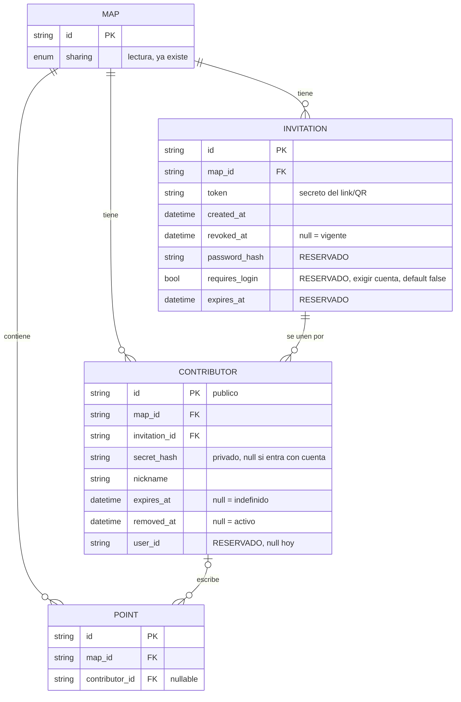
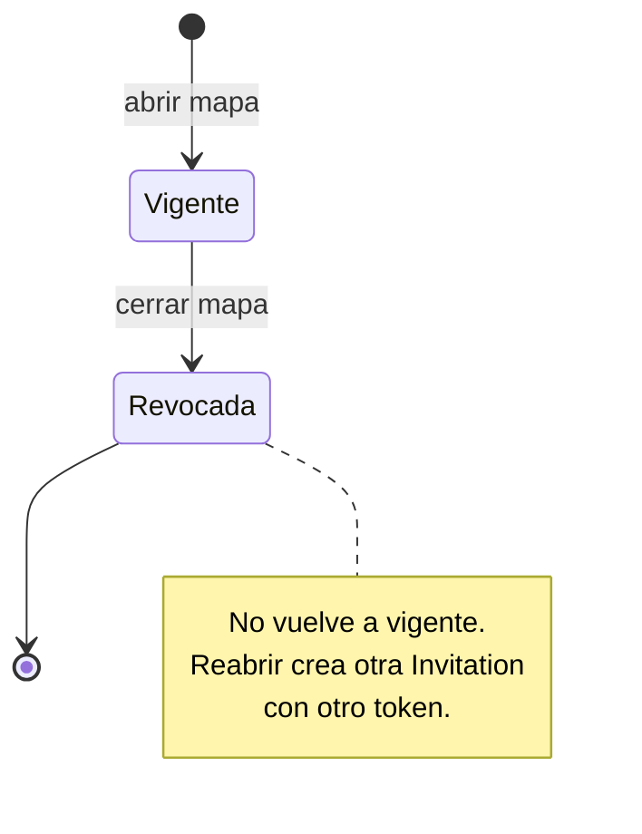
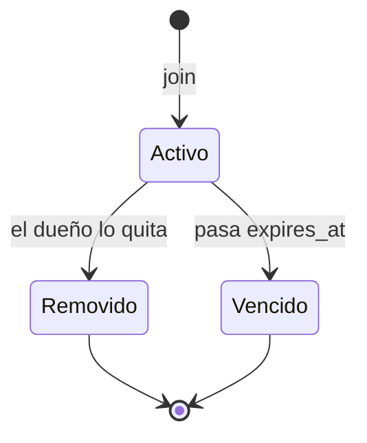
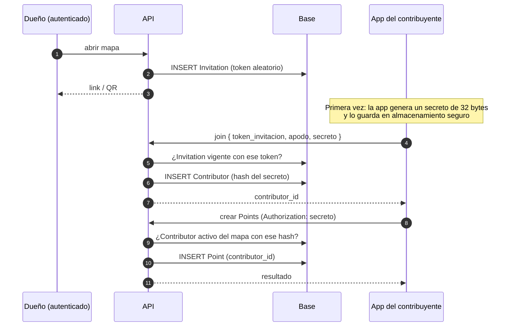

# Feature spec — Mapas abiertos a contribuciones desde la app

`chatmap-app` (Expo / React Native) permite que una persona se una a un mapa
con una invitación y agregue Points, con conexión o sin ella. Este documento
cubre la **primera parte**: cómo un mapa pasa a estar abierto a
contribuciones y cómo una persona se convierte en contribuyente. La cola
offline y el envío ordenado de Points se especifican aparte.

## Escalada a arquitectura (leer primero)

Esta feature **no se puede cerrar** sin una regla que hoy no existe en el
decision record ([live_mode.md](live_mode.md), D-001 a D-010). Las partes que
dependen de ella quedan marcadas como **pendientes**.

Hoy la API solo autoriza escrituras con `CurrentUser`: valida un JWT emitido
por **Hanko** (`hotosm_auth_fastapi`, dependencia `get_current_user`) y luego
compara `map.owner_id == user.id`. La API nunca emite ni valida credenciales
propias. Esta feature necesita exactamente eso: un endpoint de escritura
autorizado por un secreto que la API misma registra y verifica.

Falta decidir (lo debe cerrar el skill `architect`, no esta spec):

1. **Autenticación por capability token, de forma permanente.** Que un
   endpoint de escritura se autorice con un secreto de Contributor y no con
   `CurrentUser`. Es la primera credencial propia de la API y el primer
   endpoint de escritura que acepta a alguien sin cuenta. Como contribuir sin
   cuenta es una función y no un puente hacia Hanko (Decisión 6), esto no es
   transitorio: la API tendría dos tipos de principal de forma estable.
2. **Convivencia con `CurrentUser`.** Ruta separada para contribuyentes, o una
   dependencia única que pruebe ambas credenciales. Esta spec asume una única
   función de autorización que despacha según el tipo de credencial (ver
   [Decisiones](#decisiones), 6).
3. **Sin ventana de transición.** Ya no aplica: el secreto propio y el token de
   Hanko coexisten sin fecha de retiro, así que ninguna versión de la app deja
   de ser válida por este motivo.
4. **Abuso, de forma permanente.** No se ve ningún límite de volumen en la API.
   Un camino de escritura sin cuenta que no se retira necesita límites o
   cuotas estables (ver pregunta 9).

Se puede avanzar con lo local (entidades, estados, apertura y cierre). No se
debe implementar el endpoint de escritura del contribuyente hasta cerrar 1 y 2.

## Propósito

Permitir que el dueño de un mapa invite a otras personas, con una invitación
(link o QR), a agregar Points desde la app, sin que necesiten una cuenta.
Contribuir sin cuenta es una función permanente, e iniciar sesión es opcional.

## Alcance

**Dentro**

- El eje de permiso de **escritura** de un mapa, separado del de lectura.
- La entidad `Invitation` (el link/QR) y cómo abrir y cerrar un mapa.
- La entidad `Contributor` (la persona que se une) y cómo se registra.
- Cómo se autoriza un contribuyente al crear Points (el contrato, no el
  transporte offline).
- Atribución de cada Point a su contribuyente.
- Cómo conviven el contribuyente anónimo (permanente) y el autenticado con
  Hanko, y qué queda reservado para este último.

**Fuera / diferido**

- Cola offline, orden de envío y reintentos (siguiente documento).
- Implementar login de contribuyentes con Hanko. Solo se deja el lugar.
- Contraseña en la invitación. Solo se deja el lugar.
- Moderación (Points pendientes de aprobación).
- Formato del link (deep link o universal link) y pantallas de la app,
  incluida la alerta que recomienda iniciar sesión (ver Decisión 9).
- Subida de media de contribuyentes (`POST /map/media`), que hoy también
  exige `CurrentUser`.

## Vocabulario: "público" ya existe y significa otra cosa

`Map.sharing` (`PRIVATE` / `PUBLIC`, `db.py`) controla solo la **lectura**:
con `PUBLIC`, cualquiera con el link ve el mapa y aparece en el listado. Esta
feature **no lo modifica**. "Abierto a contribuciones" es un eje distinto.

| Eje | Pregunta | Dónde vive |
|---|---|---|
| Lectura | ¿Quién puede ver el mapa? | `Map.sharing` (ya existe) |
| Escritura | ¿Quién puede agregar Points desde la app? | Derivado de `Invitation` y `Contributor` (nuevos) |

Los dos son independientes. Un mapa puede ser privado en la web y estar abierto
a un equipo de campo con la app, o al revés.

## Modelo



`Point.contributor_id` es `null` para los Points que carga el dueño, el bot de
WhatsApp o una importación. Un mapa no tiene ningún campo que diga "abierto":
ese estado se deriva.

## Comportamiento

### Estado del mapa (derivado)

```
invitación vigente  =  revoked_at IS NULL
                       (y, cuando exista la columna, expires_at IS NULL o > ahora)
contributor activo  =  removed_at IS NULL
                       y (expires_at IS NULL o expires_at > ahora)

mapa ABIERTO  =  tiene al menos una invitación vigente
                 O al menos un contributor activo
mapa CERRADO  =  no tiene ninguna de las dos
```

| Invitación vigente | Contributors activos | Estado | Qué significa |
|---|---|---|---|
| sí | no | Abierto | Acepta ingresos y todavía no entró nadie |
| sí | sí | Abierto | Acepta ingresos y hay quienes escriben |
| no | sí | Abierto | El link ya no sirve, pero los que entraron siguen escribiendo |
| no | no | Cerrado | Nadie escribe ni puede entrar |

El estado se recalcula solo. Si vence o se quita al último Contributor y ya no
hay invitación vigente, el mapa pasa a cerrado sin ninguna operación. La
consulta es un `EXISTS` sobre dos tablas, con índice por `map_id`.

La base garantiza **una sola invitación vigente por mapa** con un índice único
parcial: `UNIQUE (map_id) WHERE revoked_at IS NULL`.





### Flujo completo



### Casos y bordes

| Situación | Disparador | Resultado observable |
|---|---|---|
| Abrir un mapa cerrado | El dueño autenticado pide abrir | Se crea una `Invitation` vigente y se devuelve su link/QR. El mapa pasa a abierto |
| Abrir un mapa que tiene Contributors activos pero ninguna invitación vigente | El dueño pide abrir | Se crea una `Invitation` nueva y se devuelve su link/QR. Los Contributors activos no cambian |
| Abrir cuando ya hay una invitación vigente | El dueño pide abrir | Se devuelve la misma invitación. No se crea otra (lo impide el índice único parcial) |
| Cerrar un mapa abierto | El dueño pide cerrar | En una sola transacción: la invitación vigente (si hay) pasa a `revoked_at = ahora` y todos los Contributors activos pasan a `removed_at = ahora`. El estado deriva a cerrado |
| Cerrar un mapa ya cerrado | El dueño pide cerrar y no hay invitación vigente ni Contributors activos | Sin cambios y sin error |
| Reabrir un mapa | Abrir después de cerrar | Nueva `Invitation` con otro token. El link anterior queda muerto. Los Contributors quitados al cerrar no vuelven solos (ver pregunta 11) |
| Abrir o cerrar sin ser el dueño | Usuario que no es `owner_id`, o sin sesión | Se rechaza, con la misma convención de `PUT /map/{id}/share/` |
| `join` válido | Token de una invitación vigente, secreto bien formado, apodo | Se crea un `Contributor` activo y se devuelve su `id` |
| `join` repetido | El mismo secreto en el mismo mapa | Se devuelve el **mismo** Contributor. No se crea otro |
| `join` con invitación revocada o inexistente | Token que no corresponde a una invitación vigente | Se rechaza. No se distingue "revocada" de "inexistente" |
| `join` con secreto mal formado | Largo menor a 32 bytes o formato inválido | Se rechaza y no se crea nada |
| Mismo secreto en dos mapas | La misma app se une a dos mapas | Son dos Contributors distintos, uno por mapa |
| Escritura válida | Secreto de un Contributor activo del mapa del path | Se crea el Point con `contributor_id` |
| Contributor removido | `removed_at` no es nulo | Se rechaza |
| Contributor vencido | `expires_at` es pasado | Se rechaza |
| Secreto que no existe | Hash sin fila | Se rechaza |
| Contributor de otro mapa | El `map_id` del path no es el del Contributor | Se responde como "mapa no encontrado" |
| Contributor activo con el mapa cerrado | Un Contributor activo y ninguna invitación vigente | No puede ocurrir: un Contributor activo hace que el mapa esté abierto |
| `join` con el secreto de un Contributor removido | Un secreto que ya tiene `removed_at` en ese mapa | **Pendiente** (pregunta 11) |
| Dueño escribe | `CurrentUser` con `owner_id` | Sin cambios: camino actual. El dueño no es un Contributor |
| Se borra el mapa | El dueño elimina el mapa | Se borran en cascada sus `Invitation` y `Contributor`, como ya pasa con sus Points |

## Contrato

**Nombres de ruta provisorios.** Se definen al implementar y dependen de la
escalada 2.

| Operación | Quién | Entrada | Efecto observable |
|---|---|---|---|
| Abrir mapa | Dueño (`CurrentUser`) | `map_id` | Devuelve `{ invitation_id, token, url }` |
| Cerrar mapa | Dueño | `map_id` | Revoca la invitación vigente y quita a todos los Contributors activos |
| Listar contribuyentes | Dueño | `map_id` | Contributors con apodo, estado y cantidad de Points |
| Quitar contribuyente | Dueño | `contributor_id` | `removed_at = ahora` |
| Unirse (`join`) | Sin sesión | `token_invitacion`, `apodo`, `secreto` | Crea o devuelve el Contributor |
| Crear Points | Contribuyente | Secreto en `Authorization: Bearer`, Points | Crea los Points con su `contributor_id` |

**Secretos.** Hay dos, con necesidades distintas:

| Secreto | Quién lo genera | Se guarda como | Por qué |
|---|---|---|---|
| Del contribuyente | La app, 32 bytes al azar | `secret_hash` (SHA-256) | Se muestra una sola vez, en el `join`. Con esa entropía, un hash sin sal alcanza |
| De la invitación | La API | **Pendiente** (pregunta 3) | El dueño necesita volver a ver el QR, así que no puede ser solo un hash |

El `id` público del Contributor y su secreto **son dos valores distintos**.
`Point.contributor_id` puede aparecer en exports y GeoJSON, y no puede ser una
credencial.

## Decisiones

1. **Eje de escritura separado de `sharing`.** Mezclarlos ataría "el mundo
   puede ver mi mapa" con "el mundo puede escribir en él", y al migrar los
   mapas `PUBLIC` existentes se volverían escribibles. *Descartado:* reusar
   `sharing` con otro valor.
2. **El estado abierto/cerrado se deriva de las invitaciones y los
   contribuyentes, y no se guarda.** Un flag en `Map` sería una segunda fuente
   de verdad que puede quedar desincronizada. Además, cuando vence el
   `expires_at` de una invitación o de un Contributor, un flag necesitaría un
   proceso que lo apague. Derivado, el vencimiento se resuelve solo.
   *Descartado:* `Map.contribution` (`closed`/`open`). *Consecuencia:* como el
   estado es derivado, la operación "cerrar" tiene que dejarlo cerrado de
   verdad: revoca la invitación **y** quita a los Contributors activos. *Costo
   aceptado:* reabrir genera un link nuevo, y el que ya se compartió queda
   muerto.
3. **`Invitation` y `Contributor` son entidades separadas.** La invitación es
   un link que circula por chats y pantallas, y se filtra fácil. El secreto del
   contribuyente vive solo en el teléfono. Separarlos permite quitar a una
   persona sin invalidar a las demás, y que la invitación pueda vencer sin
   echar a quienes ya entraron. *Descartado:* un token compartido que escriba
   directo (no se puede quitar a una sola persona ni saber quién escribió) y un
   link por persona (no sirve para invitar a varias personas con un QR).
4. **El secreto lo genera la app y la API guarda su hash.** Así el `join` es
   idempotente y la API no emite tokens. *Descartado:*
   - *MAC del dispositivo:* Android la oculta desde la versión 6, iOS nunca la
     expone, y un identificador no es un secreto: se transmite por el aire y el
     cliente lo puede falsificar.
   - *Token emitido por la API:* rescanear crearía otro Contributor salvo que se
     resuelva aparte.
   - *Sin ninguna validación:* el `map_id` no es secreto (aparece en URLs y en
     el listado de mapas `PUBLIC`), así que escanear el QR no serviría de nada.
5. **Los tokens de Hanko no se pueden delegar.** Hanko no ofrece API keys ni
   tokens delegados. Su Admin API puede crear una sesión para un `user_id`, pero
   emite un JWT **como ese usuario**, sin vencimiento propio por token y con la
   API key de administración. Usarlo haría pasar a los contribuyentes por el
   dueño. *Consecuencia:* quien entra con cuenta lo hace con su propio JWT, y
   el mapa se enlaza con `Contributor.user_id`.
6. **El contribuyente anónimo es permanente, no un puente hacia Hanko.**
   Mapear sin crear cuenta es una función para quien quiere sumarse sin
   registrarse. El secreto propio y el JWT de Hanko coexisten sin fecha de
   retiro. *Descartado:* tratar el secreto como una credencial transitoria que
   Hanko reemplaza. *Consecuencia:* hay una única función de autorización,
   `authorize_contribution(map_id, request)`, que **despacha según el tipo de
   credencial**: con el secreto busca al Contributor por `secret_hash`, y con un
   JWT de Hanko lo busca por `(map_id, user_id)`. La pregunta es la misma en
   los dos casos: "¿hay un Contributor activo de este mapa para esta
   credencial?". Ningún endpoint valida por su cuenta. Está sujeta a la
   escalada 2.
7. **Contributors en tabla y no en un array de `Map`.** Cada uno tiene apodo,
   vencimiento, `removed_at`, `user_id` y `secret_hash`. Buscar por secreto,
   indexar y garantizar unicidad con un array sería mucho más incómodo.
8. **El apodo es autodeclarado.** No es una identidad verificada. La identidad
   real llega con `user_id`.
9. **Perder el dispositivo pierde la identidad anónima, y se acepta.** El
   secreto vive solo en el teléfono: si la persona reinstala la app o cambia de
   dispositivo, genera otro secreto y aparece como otro Contributor. Sus Points
   anteriores quedan atribuidos al Contributor viejo, y el dueño puede quitarlo.
   *Descartado:* un código de recuperación para restaurar el secreto sin
   cuenta, porque agrega un segundo secreto que también se puede perder.
   *Mitigación:* la app mostrará una alerta que recomienda iniciar sesión para
   no perder las contribuciones. El reclamo que enlaza el historial anónimo con
   el `user_id` está en la pregunta 7.

## Coexistencia de credenciales

Un Contributor tiene **una credencial por fila**, y su tipo se deriva de cuál
está presente. No hay una columna `type`.

| Credencial en la fila | Tipo | Quién la verifica | Estado |
|---|---|---|---|
| `secret_hash` | Anónimo | Nadie: es un secreto que generó la app | v1 |
| `user_id` | Autenticado | Hanko | Reservado, no se implementa ahora |
| `whatsapp_sender_hash` | WhatsApp | WhatsApp, que garantiza el remitente | Diferido: es otra feature (filtro del modo live), con su propia spec |

El tipo anónimo no desaparece cuando exista Hanko. Lo que no se implementa
ahora es el camino autenticado, y esto es lo que queda preparado:

| Dónde | Qué queda pensado |
|---|---|
| Base | `Contributor.user_id` y `secret_hash` nullable, porque un Contributor autenticado puede no tener secreto propio. `Invitation.requires_login` y `password_hash` reservados. `requires_login` sería la forma de que el dueño exija cuenta, con default `false` |
| API | `authorize_contribution` despacha según el tipo de credencial |
| App | Una sola función que entrega la credencial de escritura: el secreto guardado o el token de Hanko |
| Historial | Quien inicia sesión puede reclamar lo que aportó como anónimo (pregunta 7) |

## Preguntas abiertas

1. **Dejar de aceptar ingresos sin cortar a quienes ya entraron.** Con la
   definición de abierto, *cerrar* corta a todos. El estado sí admite "sin
   invitación vigente y con Contributors activos" (sigue abierto), pero no hay
   una operación del dueño que lo provoque, salvo que la invitación venza.
   ¿Hace falta una acción aparte que revoque solo la invitación? Se conecta con
   los Points offline que llegan tarde (documento offline).
2. **Origen del vencimiento del Contributor.** ¿Lo fija la invitación como
   política ("quien entre por este link tiene 7 días") y se copia al entrar, o
   se decide por persona?
3. **Guardado del token de la invitación.** En claro (simple; una filtración de
   la base expone los QR de los mapas abiertos) o cifrado reversible (como
   D-004 hace con el contenido de mensajes; se puede volver a mostrar y no se
   puede usar sin la clave).
4. **Points offline con secreto revocado.** Un Contributor que sacó Points sin
   conexión y los envía después de que lo quitaron: ¿se rechazan todos, o se
   aceptan los anteriores al momento de la baja? Requiere que el Point lleve su
   hora de creación. Va al documento offline.
5. **Rescaneo.** ¿Volver a unirse con el mismo secreto actualiza el apodo o se
   conserva el primero?
6. **`Point.username`.** ¿Lo completa el servidor con el apodo del Contributor
   (no se puede falsificar por Point) o lo manda la app?
7. **Reclamo de historial.** Es una función permanente: quien aportó como
   anónimo e inicia sesión conserva lo que hizo, y la app lo recomienda
   (Decisión 9). Falta definir cómo asocian su `user_id` los Contributors
   anónimos, qué pasa si ya existe otro Contributor para ese usuario en el
   mapa, y si al reclamar se retira el `secret_hash` para volver a una
   credencial por fila.
8. **Formato del link/QR.** Deep link (`chatmap://`) o universal link, y qué
   ve alguien sin la app instalada.
9. **Límites y cuotas** por Contributor (ver escalada 4). Y si la invitación
   lleva un tope de ingresos (`max_uses`): cuando se llena deja de servir. Hay
   que decidir si un `join` repetido con el mismo secreto cuenta como un uso
   (lo lógico es que no, porque es el mismo Contributor).
10. **Reinstalación.** Resuelta en la Decisión 9. El dueño ve a los Contributors
    huérfanos con "Listar contribuyentes" y los quita con "Quitar
    contribuyente".
11. **`join` con el secreto de un Contributor removido.** El `join` es
    idempotente por `(map_id, secret_hash)`, así que hay que decidir qué hace
    con un secreto que ya tiene `removed_at`. Si lo **rechaza**, quitar es un
    bloqueo, pero como *cerrar* quita a todos, reabrir el mapa dejaría afuera a
    todos hasta que reinstalen la app. Si lo **reactiva**, quitar a alguien no
    sirve mientras siga vigente el QR que ya tiene. Una salida es distinguir en
    la baja si fue individual o por cierre del mapa.
