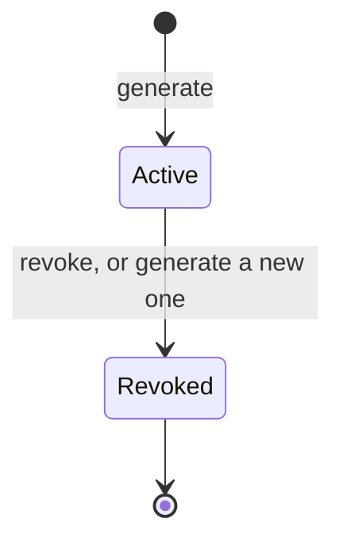
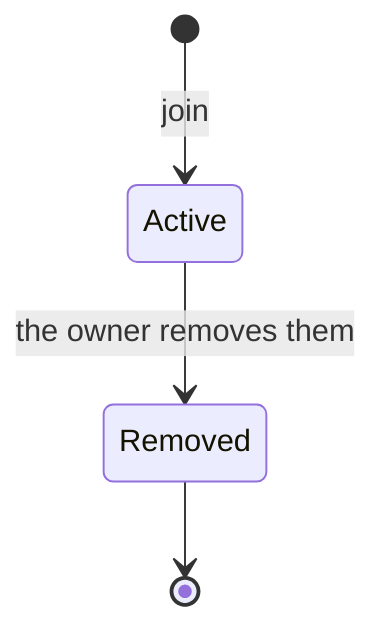
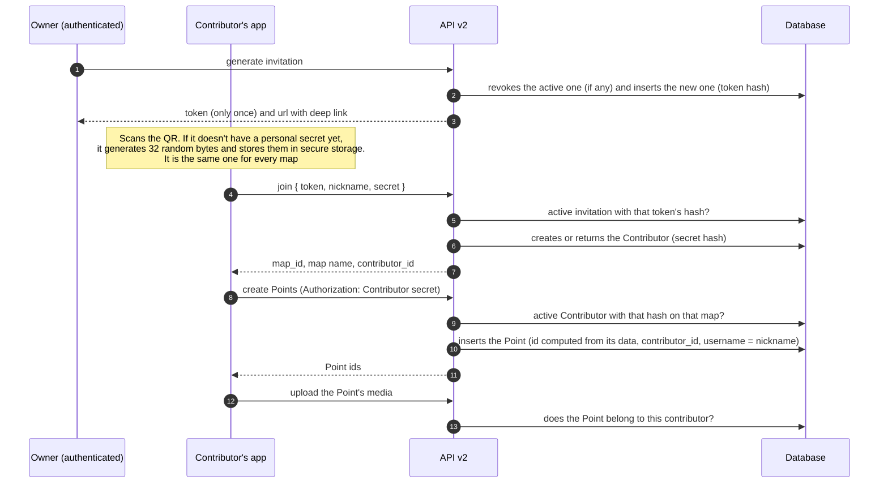

# Feature spec — Contributions from the app

`chatmap-app` (Expo / React Native) lets a person join a map with an invitation
and add Points and media, online or offline. This document covers the **first
delivery**: how the owner invites, how a person becomes a contributor, and how
what they write is authorized. The offline queue and the ordered sending of
Points are specified in [offline_contributions.md](offline_contributions.md).

**Version vocabulary.** "API v1" and "API v2" are the `/v1` and `/v2` routes.
"First delivery" is the first scope of this feature. They are different things.

**Premise.** The app connects to **a single server**, fixed when it is built.
Anyone who deploys their own instance needs their own build of the app. That is
why the QR doesn't need to carry the server address.

## Architecture decisions (resolved in this spec)

These two rules cut across the whole API and didn't exist in the decision record
([live_mode.md](live_mode.md), D-001 to D-010). They were resolved here and
**live in this spec**. Other specs that need them can link to them from this
document.

**A1. The API accepts two kinds of writer.** Today it authorizes writes only
with `CurrentUser`: it validates a JWT issued by Hanko (`hotosm_auth_fastapi`)
and compares `map.owner_id == user.id`. It now also accepts the **contributor**,
identified by a secret that the API itself registers and verifies. It isn't a
bridge until Hanko is in place: contributing without an account is a permanent
feature. The contributor secret can only do what is declared in
[Contract](#contract): join, create Points and upload media to **their own**
Points. It can never reach owner operations.

**A2. Coexistence with `CurrentUser`.**

- All new code lives in **API v2** (`api/v2`). API v1 is not touched.
- **No route accepts contributors unless it says so.** By default a route
  accepts only the owner.
- The secret travels in `Authorization: Contributor <secret>`, a custom scheme
  that can be told apart, without guessing, from the `Bearer` of Hanko's JWT. In
  `join` it goes in the body, because there is no registered secret yet.
- If a request carries both credentials, only the secret is used. The rule is
  applied once, when reading the credentials, and holds for every endpoint,
  including reading media.
- The caller's role on a map (owner or contributor) is resolved in a route
  dependency, which responds 401, 403 or 404 if they have none. The store
  receives the role and never the credentials. A single function,
  `role_in_map`, decides the role (see [Credential coexistence](#credential-coexistence)).

## Purpose

Let a map's owner invite people who use the app, with a QR, to add Points and
media to their map without needing an account. Logging in is optional.

## Scope

**In scope**

- The map's **write** permission axis, separate from the read one.
- The `Invitation` entity (the QR): generating, viewing and revoking it.
- The `Contributor` entity (the person who joins): registering, listing and
  removing them.
- Authorizing a contributor to join, create Points and upload media to their
  own Points.
- Attributing each Point to its contributor.
- Querying who joined through an invitation within a date range.
- How the anonymous contributor (permanent) and the one authenticated with
  Hanko coexist.

**Out of scope / deferred**

- **Pausing a map** or leaving it "closed": it doesn't exist in the first
  delivery. The only immediate brake is removing a contributor.
- **Bulk removal** (for example, removing everyone who joined through an
  invitation). The model already allows querying it, see
  [Decisions](#decisions), 15.
- **Blocking a device on every map, including new ones.** The same device can
  already be recognized by its `secret_hash`. What's missing is storing the
  block separately, so that it applies to maps it hasn't joined yet.
- **Expiry of the contributor** and of the invitation.
- **Rate limiting and abuse:** `max_uses`, per-map caps, a media size cap. They
  must be closed before exposing `join` and writing outside development (see
  question 6).
- **Reading for contributors** on private maps.
- Contributor login with Hanko, and a password on the invitation. Only the room
  for them is left.
- Offline queue and retries: see [offline_contributions.md](offline_contributions.md).
- Moderation (Points pending approval).
- Live mode filter by WhatsApp sender (another feature).
- The app's screens, including the alert that recommends logging in.

## Vocabulary: "public" already exists and means something else

`Map.sharing` (`PRIVATE` / `PUBLIC`, `db.py`) controls only **reading**. This
feature **doesn't change it**.

| Axis | Question | Where it lives |
|---|---|---|
| Read | Who can see the map? | `Map.sharing` (already exists) |
| Write | Who can add Points from the app? | `Invitation` and `Contributor` (new) |

The two are independent. A **private** map is seen only by its owner, even if
it has contributors.

## Model

- `Point.contributor_id` is `null` for Points from the owner, the WhatsApp bot
  and imports.
- **A single active invitation per map**, guaranteed by a partial unique
  index: `UNIQUE (map_id) WHERE revoked_at IS NULL`.
- `UNIQUE (map_id, secret_hash)` on `contributors`, plus one index on
  `(invitation_id, created_at)` and another on `secret_hash`. The same
  `secret_hash` appears in one row for each map that person joined.
- Foreign keys to `maps` carry `ON DELETE CASCADE`, so that
  `DELETE /v1/map/{id}` keeps working without touching API v1.
  `contributors.invitation_id` also cascades, so that deleting a map doesn't
  depend on the order in which the database deletes its rows.
- Dates in the new tables are **UTC with time zone**. The rest of the code
  stores local time without a zone, and that isn't changed.

**Reserved, not created now:** `invitations.password_hash`,
`invitations.requires_login`, `invitations.expires_at`, `contributors.user_id`
and `contributors.expires_at`.

## Behavior

### States

| Entity | States | How it's computed |
|---|---|---|
| Invitation | **Active** or **revoked** | `revoked_at IS NULL` |
| Contributor | **Active** or **removed** | `removed_at IS NULL` |

- The active invitation controls **who gets in** (`join`).
- An active Contributor controls **who writes**.
- **There is no "open/closed" state for the map.** Revoking the invitation
  doesn't affect those who already joined.

### Full flow

### Cases and edge cases

| Situation | Trigger | Observable result |
|---|---|---|
| Generate with no active invitation | The owner asks to generate | An active invitation is created. The token is returned **only once**, along with the `url` |
| Generate with an active invitation | The owner asks to generate | In a single operation: the active one gets `revoked_at = now` and the new one is created. Contributors are not affected |
| View the active invitation | The owner queries it | Its data is returned (`id`, `created_at`, how many joined), **never the token**. If there is no active one, none is returned |
| Revoke | The owner asks to revoke | `revoked_at = now`. Nobody new gets in. Contributors keep writing |
| Revoke with no active invitation | The owner asks to revoke | No changes and no error |
| Generate, view or revoke without being the owner | A user who isn't `owner_id`, or no session | Rejected, following the convention of `PUT /map/{id}/share/` |
| Valid `join` | Token of the active invitation, well-formed secret, nickname | An active Contributor is created (with `invitation_id` and `created_at`). Responds **201** with `contributor_id`, `map_id` and the map name |
| Repeated `join` | The same secret on the same map, with the active invitation | **Does nothing.** Responds **200** (instead of 201) with the same Contributor, and that is the signal for the app to show a notice. The nickname, `invitation_id` and `created_at` don't change |
| `join` with a revoked or nonexistent invitation | A token that doesn't match an active invitation | Responds **404** and **no row is created**. "Revoked" isn't distinguished from "nonexistent". This also applies to someone who was already a contributor: they can't join again with that QR, but they can still write |
| `join` with a malformed secret | Length other than 43 characters, or characters outside base64url | Responds **422** and nothing is created |
| `join` with the secret of a removed Contributor | The secret already has `removed_at` on that map | Responds **403**. It is a block, and it differs from the 404 so the app can tell the person they were removed |
| Same phone, another map | The app joins two maps | The same secret and two Contributors, one per map. Each has its own state: removing it from one map doesn't affect the other. The server can recognize that they share `secret_hash` |
| Valid write | Secret of an active Contributor of the map | The Point is created with `contributor_id` |
| Retry of a Point | The same data from the same contributor | The server computes the same id and returns the existing Point (200). It isn't modified |
| A removed Contributor writes | `removed_at` is not null | Rejected |
| Remove a contributor | The owner removes them | `removed_at = now`. Their Points are **not deleted or modified**. Hiding them is the front end's job (question 2) |
| Secret that doesn't exist | Hash with no row | Rejected |
| Contributor of another map | The requested `map_id` isn't theirs | Answered as "map not found" |
| Upload media to one's own Point | The Point has their `contributor_id` | Attached |
| Upload media to someone else's Point | A Point of the owner, the bot or another contributor | Rejected |
| A contributor reads a private map | Any read | Rejected: on a private map only the owner reads |
| The owner writes | `CurrentUser` with `owner_id` | No changes. The owner isn't a Contributor |
| The map is deleted | The owner deletes the whole map | Its invitations and contributors are deleted in cascade. It is the only thing that deletes a Contributor: one at a time, they are only marked as removed |
| The device is lost | Changing phones, or reinstalling the app (on Android) | Another secret is generated, and the person is a new identity on **all** their maps: a new Contributor for each one they join again. The old ones stay until the owner removes them. On iOS, reinstalling may keep the secret, with no guarantee |

## Contract

**Route names are provisional**, except the media one, which already exists.

| Operation | Who | Input | Observable effect |
|---|---|---|---|
| Generate invitation (`POST /v2/maps/{map_id}/invitations`) | Owner (`CurrentUser`) | `map_id` | Revokes the active one, creates a new one and returns `{ id, token, url, created_at }`. The token only travels in this response |
| View active invitation | Owner | `map_id` | The invitation's data, without the token |
| Revoke invitation | Owner | `map_id` | `revoked_at = now` |
| List contributors | Owner | `map_id`, optional filters `invitation_id`, `from` and `to` (on `created_at`) | Nickname, `created_at`, `invitation_id`, `removed_at` and number of Points |
| Remove contributor | Owner | `contributor_id` | `removed_at = now`. Permanent |
| Join (`POST /v2/invitations/join`) | No session: the token authorizes it | `token`, `nickname`, `secret` | Responds **201** if it creates the Contributor and **200** if it already existed. Returns `{ contributor_id, map_id, map_name }`. Errors: 404 invalid invitation, 403 removed contributor, 422 malformed request |
| Create Point (`POST /v2/points`, extended to accept contributors) | Owner or contributor | `Authorization: Contributor <secret>` and the Point, without `id`, with the capture time required | Responds 201 with the id the server computes from the data, or 200 with the same id if a Point with that data already existed. Errors: 401 no credential or a malformed secret, 403 contributor without access or removed, 404 nonexistent map, 422 invalid request. If it carries `Authorization: Contributor`, that credential decides even if there is a session. See [create_point.md](create_point.md) and [offline_contributions.md](offline_contributions.md) |
| Upload media | Contributor or owner | `POST /v2/points/{point_id}/media`, with the file and `captured_at` | Attaches it if the Point is theirs. This existing route now declares that it accepts contributors. `captured_at` is required: the time the user attached the media in the app, with time zone. It is validated like the Point's `time`: without a zone it responds 422, and a future time is accepted. The server stores it in UTC and never uses the time it received the file. Media uploaded before this field existed has no time (`null`) |

**The QR** carries a link with the custom scheme `hot-chatmap://`, built by the
server (the `url` field). It contains **only the token**: the app already knows
which server to talk to, and the token resolves which map it belongs to. The
`map_id` reaches the app in the `join` response. The format is
`hot-chatmap://join?token=<token>`.

**Contributor's Point: what the server accepts**

| Field | Does the app send it? | What the server does |
|---|---|---|
| Coordinates | Yes | Validates the ranges |
| `message` | Yes | Stores it as is |
| `time` (capture) | Yes | Accepts it as is, whether old or in the future. Without a time zone it responds 422 |
| Id | No | The server computes it from the sender, the map, the capture time, the coordinates and the message |
| `username` | No | Filled in with the Contributor's nickname |
| `file` | No | Media goes through the media route, after the Point is created |
| `tags` | No | Left for the owner |
| `removed` | No | Always `false` |

**Secrets.** There are two, with different needs:

| Secret | Who generates it | How many there are | Stored as | What it's for |
|---|---|---|---|---|
| Invitation token | The API | One per invitation, shared by everyone who scans it | `token_hash`. **Shown only once** | Proving "the owner invited me", only when joining |
| Personal secret | The app, 32 random bytes | **One per install**, the same for every map | `secret_hash` | Proving "I am this contributor", on every write |

The hashes are unsalted SHA-256: with 32 random bytes nothing more is needed.
The Contributor's public `id` and its secret are two different values, because
`Point.contributor_id` can appear in exports and GeoJSON.

**Personal secret format.** It is 32 random bytes written in **base64url
without padding**: 43 characters from `A-Z`, `a-z`, `0-9`, `-` and `_`. The
server rejects anything else, because that is what guarantees the secret has
the strength this spec claims, and it hashes the text exactly as it arrives. It
is the same format as the invitation token.

**`join` request: what the server accepts**

| Field | Rule |
|---|---|
| `token` | Non-empty text. Compared by its hash against the active invitations |
| `nickname` | Leading and trailing spaces are trimmed, and it can't end up empty. It has no length cap yet (see question 6) |
| `secret` | The format above |

## Decisions

1. **Write axis separate from `sharing`.** Mixing them would tie "the world can
   see my map" to "the world can write to it", and when migrating, existing
   `PUBLIC` maps would become writable. *Discarded:* reusing `sharing` with
   another value.
2. **The invitation controls who gets in, the active Contributor controls who
   writes, and there is no "open/closed" state or pause.** *Discarded:* a flag
   on `Map`, and deriving "open" from the invitations and contributors, which
   forced removing everyone to close it. *Accepted cost:* there is no general
   brake, and the only immediate one is removing people one at a time. Pausing
   is out of scope.
3. **`Invitation` and `Contributor` are separate entities.** The QR token
   circulates through screens and chats, and leaks easily. The personal secret
   lives only on the phone. Separating them makes it possible to remove one
   person without invalidating the others, and to know who wrote each Point.
   *Discarded:* a shared token that writes directly (you can't remove a single
   person or attribute anything) and a link per person (it doesn't work to
   invite several people with one QR).
4. **The personal secret is generated by the app, one per install and the same
   for every map, and the API stores its hash.** That makes `join` idempotent,
   and the API doesn't issue credentials. Since the app connects to a single
   server, a QR can't make it hand its secret to another server.
   *Consequences:* the same `secret_hash` appears in one row per map, which
   makes it possible to recognize the same device across maps (to block it
   where it already is, or to merge its history when logging in) without a
   users table. A leaked secret affects all of that person's maps.
   *Discarded:*
   - *Device MAC:* Android hides it since version 6, iOS never exposes it, and
     an identifier isn't a secret.
   - *Token issued by the API:* rescanning would create another Contributor.
   - *No validation at all:* the `map_id` isn't secret (it appears in URLs and
     in the list of public maps).
   - *One secret per map:* it was meant to protect against a fake server, which
     isn't possible if the app talks to a single server. The cost was not being
     able to recognize the same device across maps.
5. **Hanko tokens can't be delegated.** Hanko offers neither API keys nor
   delegated tokens. Its Admin API can create a session for a `user_id`, but it
   issues a JWT **as that user**, with no per-token expiry of its own and using
   the admin API key. It would make contributors pass as the owner.
   *Consequence:* whoever joins with an account does so with their own JWT, and
   the Contributor is linked with `user_id`.
6. **The anonymous contributor is permanent, not a bridge to Hanko.** The
   custom secret and Hanko's JWT coexist with no retirement date, so there is no
   transition window. *Discarded:* treating the secret as a temporary
   credential. A single function, `role_in_map`, decides whether the caller is
   the owner or a contributor of a map. The route dependencies and the media
   read use it, and the stores receive the role already resolved.
   *Discarded:* having each store decide the role from the credentials, because
   it spread the rule about which credential wins, and the choice of error,
   across several files.
7. **Contributors in a table, not in an array on `Map`.** Each one has a
   nickname, dates, `removed_at` and `secret_hash`. Looking up by secret,
   indexing and guaranteeing uniqueness with an array would be much more
   awkward.
8. **The nickname is self-declared.** It isn't a verified identity. Real
   identity comes with `user_id`.
9. **Losing the device loses the anonymous identity, and that is accepted.**
   The person shows up as another Contributor on each map they join again, and
   their earlier Points stay attributed to the old ones. The secret is stored
   with `expo-secure-store`: on Android it doesn't survive reinstalling the app,
   and on iOS it lives in the Keychain, which according to the Expo docs may be
   kept after uninstalling, though that isn't guaranteed, so it shouldn't be
   relied on. *Discarded:* a recovery code, because it adds a second secret that
   can also be lost. *Mitigation:* the app will show an alert recommending
   logging in so as not to lose contributions.
10. **The invitation token is stored as a hash and shown only once. Generating
    a new one revokes the previous one.** The database needs to recognize and
    revoke the invitation, not keep the token: with the hash, whoever reads the
    database can't join any map. Since there is at most one active invitation
    and the UI can always show its data (without the token), there are no
    valid, invisible invitations. *Discarded:* storing it in clear; a
    recoverable token computed with a server key; several active at once.
    *Accepted cost:* a QR handed to someone who hasn't scanned it yet stops
    working when a new one is generated. The UI must warn about it and offer to
    download the QR when it is created.
11. **The contributor's Point fields** follow the table in
    [Contract](#contract). The server fills in `username`, so that nobody signs
    a Point as someone else.
12. **Replaced by Decision 6 of
    [offline_contributions.md](offline_contributions.md).** It used to say the
    Point id was derived with `uuid5(contributor.id, client_id)`, with a
    `client_id` sent by the app. Now the server computes the id only from the
    Point's data, with nothing sent by the app. It still holds that API v1's
    `add_points` isn't reused, since it does `ON CONFLICT DO UPDATE` and would
    overwrite data.
13. **The QR is a link with the custom, unique scheme `hot-chatmap://`, built
    by the server.** The app's scanner reads it directly, and the scheme also
    lets the phone's camera open the app. It is the usual approach in apps that
    link devices or accounts with a QR (for example Signal and Nextcloud). The
    name isn't exclusive on the device: another app could register the same
    scheme, and that is why security doesn't depend on it. *Discarded:*
    - *The `chatmapapp` scheme:* it comes from the project name in the Expo
      template and isn't a production identifier.
    - *Universal links:* since the app has a single server, they would now be
      possible, but they require declaring the domain at build time and serving
      verification files from the server. They can be added later.
    - *Plain text with no scheme:* simpler, but it departs from the usual
      approach and the phone's camera couldn't open the app.
14. **Private map: only the owner sees it.** Reading for contributors is
    deferred.
15. **The history per invitation comes from the model.**
    `contributors.invitation_id` and `created_at` make it possible to query who
    joined through an invitation within a range, including the removed ones. A
    repeated `join` keeps the first invitation and date. The removal mechanism
    is out of scope.
16. **A repeated `join` does nothing.** If someone who is already a contributor
    scans that map's QR again, no row is modified, and the response says they
    already were one. The app shows a notice.
17. **Removing a contributor doesn't touch their Points.** They stay in the
    database. Hiding the Points of a removed contributor is the front end's job.
    *Consequence:* the front end needs to know who each Point belongs to (see
    question 2).

## Credential coexistence

A Contributor has **one credential per row**, and its type is derived from
which one is present. There is no `type` column.

| Credential in the row | Type | Who verifies it | Status |
|---|---|---|---|
| `secret_hash` | Anonymous | Nobody: it is a secret the app generated | First delivery |
| `user_id` | Authenticated | Hanko | Reserved |
| `whatsapp_sender_hash` | WhatsApp | WhatsApp, which guarantees the sender | Deferred, another feature |

The anonymous one doesn't go away once Hanko is in place. That is why
`secret_hash` has to accept empty values: an authenticated contributor has no
secret of their own.

## Open questions

1. **Resolved** (Decision 16): a repeated `join` does nothing.
2. **How the front end reads the contributors' Points and media.** To be
   discussed in another session. There are two needs that API v1 doesn't cover
   today:
   - **Media:** API v1 only shows the media in `points.file`, and v2's lives in
     the `media` table, so the web doesn't see it. Options: (1) v2 also stores
     in `points.file` a link with a compatible shape (photos yes, video and
     audio no); (2) the above plus a minimal exception in v1 for the player;
     (3) the web combines what comes from v1 and from v2; (4) no media on the
     web. It depends on whether the owner needs to see video and audio.
   - **Hiding the Points of a removed contributor** (Decision 17): API v1
     doesn't return who each Point belongs to, so the front end can't filter
     them with what it reads today. It needs `contributor_id`, or an equivalent
     mark, in what it reads.
3. **Resolved** (Decision 17): the Points of a removed contributor stay, and
   the front end hides them.
4. **Resolved** (Decision 8 of
   [offline_contributions.md](offline_contributions.md)): if you were removed,
   the queued Points aren't inserted.
5. **Claiming history.** Someone who contributed anonymously and then logs in
   keeps what they did, and the app recommends it (Decision 9). With one secret
   per install, the claim can fill in `user_id` on all their rows at once. Still
   to define: what happens if another Contributor of theirs already exists on
   the map, and whether claiming retires the `secret_hash` to get back to one
   credential per row.
6. **Abuse and rate limiting.** Deferred, and **must be closed before exposing
   `join` and writing outside development**. It includes `max_uses` on the
   invitation (a repeated `join` wouldn't count), a cap on contributors per
   map, a media size cap, a nickname length cap and the rate limit for `join`.
7. **Preview before joining.** Does the app show the map name before
   confirming? It would require a read endpoint that takes the token. Today the
   name arrives in the `join` response.
8. **Shape of `requires_login`.** A boolean, or a set of allowed types per
   invitation? Reserved for now.
9. **Live mode filter by WhatsApp sender.** Another feature, with its own spec:
   how the contributor enrolls, the explicit per-map mode, retroactivity within
   the 30 minutes, and how the connector normalizes WhatsApp identifiers.
10. **Expiry of the contributor and of the invitation**, and reading for
    contributors on private maps. Deferred.
11. **App identifiers before publishing.** The scheme is already `hot-chatmap`
    in `app.json`. The Android `package` (`com.anonymous.chatmapapp`) and the
    iOS identifier still have template values.
