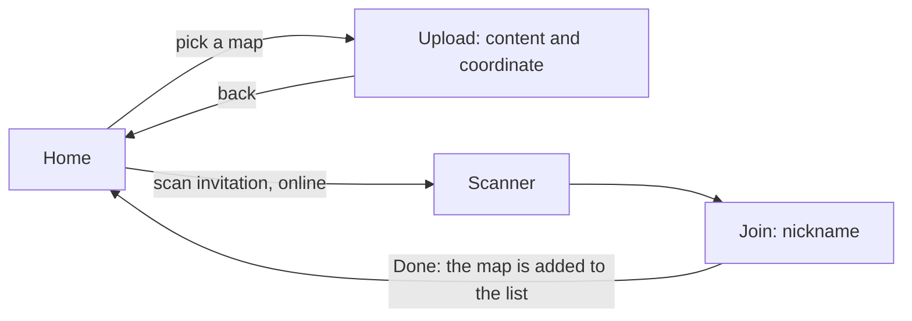
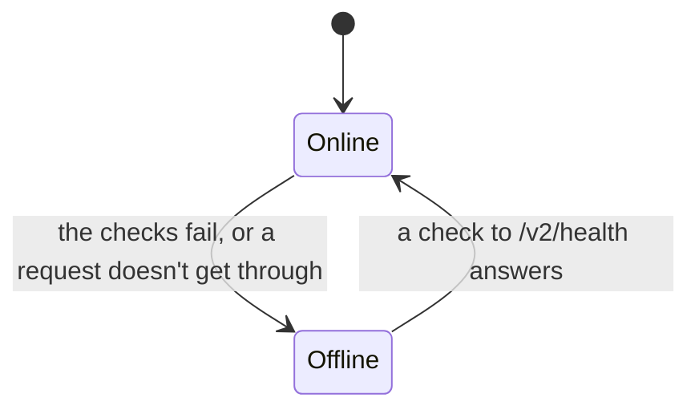
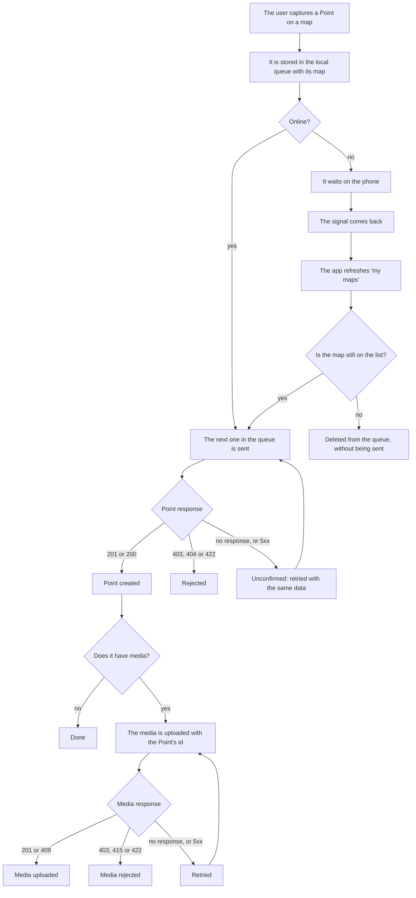
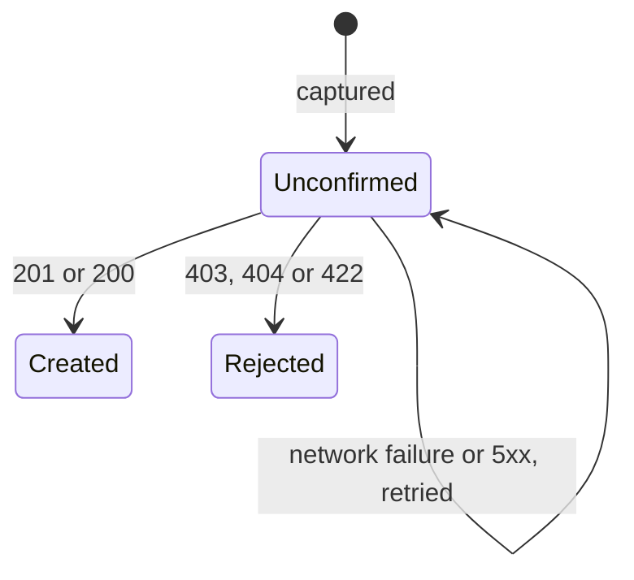
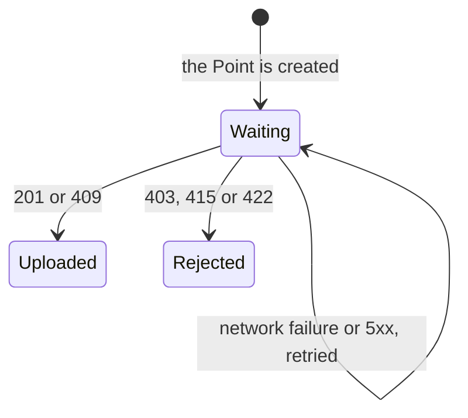

# Feature spec — Offline contributions

`chatmap-app` captures Points and media in the field, where the connection is
unreliable. This document defines how the app detects that it has no
connection, how it captures in the meantime, and how it uploads what it captured
when the signal comes back. It continues
[map_contributions.md](map_contributions.md), which defines who can contribute
and how they are authorized.

## Purpose

Let a person keep capturing Points and media offline, without losing or
duplicating data, and have them upload on their own to the map they were
captured for once the signal comes back.

## Scope

**In scope**

- Detecting whether the app can reach our server.
- Storing and refreshing the list of maps on the phone.
- Capturing offline for a map on that list, and uploading what was captured.
- The states the user sees for each Point and for its media.
- The history of what the user uploaded to a map, read from the server.
- Making sure a retry doesn't create a duplicate Point (the id is computed from
  the data).
- The new endpoints (`health`, "my maps", "my Points on a map") and the change
  to Point creation.
- The app's two screens and what each one does.

**Out of scope / deferred**

- **Guaranteeing that the copy is up to date before going into the field.** The
  app refreshes the list when it can, but doesn't stop the user from going out
  with an old one: that is the user's responsibility.
- A manual mode to force the offline state.
- Background refresh with the app closed, and periodic refresh with the app
  open.
- Querying the status of the uploads in bulk (Decision 16).
- Storing the history of what was already created on the phone (Decision 12).
- Login with Hanko, moderation and abuse control (see
  [map_contributions.md](map_contributions.md)).

## Premises

- **The server is the source of truth.** What's on the phone is a copy: the
  list of maps and the send queue. The history of what was already created **is
  not stored**: it is read from the server every time.
- **Joining a map needs a connection**, because `join` goes to the server.
  Offline, scanning an invitation must say so. On joining, the map is added to
  the stored list with the `join` response.
- **The list of maps is stored on the phone** and can be out of date. Keeping
  the list up to date before going out is the user's responsibility.
- Local storage is `expo-sqlite`.

## Screens



| Screen | Online | Offline |
|---|---|---|
| **Home** | The list of maps you contribute to, refreshed, with the time of its last update, and the button to scan an invitation | The last stored list, with the time of its last update. Any map on the list can be picked. Scanning says that it needs a connection |
| **Upload** | The current content and coordinate screen, for the chosen map. It shows the history of what the user uploaded to that map (read from the server) together with what's in the queue, each item with its state. All photos and videos are drawn with the same aspect ratio, whether they are in the queue or in the history. Videos and audios load only when the user taps them. Each bubble shows the date and time the user sent it in the app: for the location, the Point's capture time; for the media, the time it was attached | The same, but **without history**: only what's in the queue is shown (unconfirmed and rejected). From there the user can go back to Home and pick another map |

## Updating the list of maps

The list is requested with "my maps" (see [Contract](#contract)) and the
response **replaces** the stored copy. It is refreshed:

- when Home is opened while online,
- when the connection comes back, before sending whatever is in the queue,
- with a pull-to-refresh gesture.

There is no periodic refresh. Home shows the time of the last update. If the
refresh fails, the last list is kept.

A contributor always has at least one map on the list: joining needs a
connection and adds the map to the local copy.

## Connectivity detection

The app has two states, **online** and **offline**, and its own module decides
them. What matters isn't whether the phone has a network, but whether **our
server answers**. A phone can be connected to a Wi-Fi network with no internet
access: `expo-network` documents that `isConnected` doesn't imply reachable
internet, and that on iOS `isInternetReachable` is always the same as
`isConnected`.



| Source | What it's for |
|---|---|
| System notifications (`expo-network`) | They trigger an immediate check when the network changes |
| Periodic check to `GET /v2/health`, with the app open | Detects a network that doesn't reach the server, even if nobody is doing anything |
| The result of each real request | One more signal, at no cost: if a request fails because of the network, there's no need to wait for the next check |

- The check is **the same on iOS and on Android**. Android's native signal
  serves as a trigger, but doesn't decide, because "validated internet" doesn't
  mean our server answers.
- It only counts as "no connection" when the request **doesn't get through**.
  If the server answers with an error (403, 404, 500), it got through, and the
  app stays online.
- With the app closed there is no detection.

**Parameters.** They start with these standard values and are changed with the
app's environment variables, which are set when it is built. The names are
provisional.

| Parameter | Initial value | Variable |
|---|---|---|
| How often to check, while online | 30 s | `EXPO_PUBLIC_HEALTH_INTERVAL_MS` |
| How long to wait for a check's response | 5 s | `EXPO_PUBLIC_HEALTH_TIMEOUT_MS` |
| Consecutive failures to go offline | 2 | `EXPO_PUBLIC_HEALTH_FAILURES_TO_OFFLINE` |
| Pause between checks while offline | Starts at 5 s, doubles, up to a maximum of 60 s | `EXPO_PUBLIC_HEALTH_RETRY_MIN_MS`, `EXPO_PUBLIC_HEALTH_RETRY_MAX_MS` |

A single check that answers is enough to go back online. The same pause times
are used to retry an upload that got a 5xx.

## Capture and upload



A single mechanism handles both cases: every Point goes through the local
queue, online or offline. Online, it is sent right away. Offline, it waits.

**There is a single queue, ordered by capture time**, not split by map. Within
a map, the capture order is respected. Across maps it doesn't change the result
on the server, because no Point depends on one from another map. A rejection
doesn't stop the queue: it is marked and the next one is sent. A network failure
does stop it, because nothing can be sent until the connection comes back.

**What each queue item stores on the phone**

| Data | Detail |
|---|---|
| Capture time | The one the app set when the user captured, not the send time nor the time the server sees when it receives it |
| Media time | Only if it has media: the one the app set when the user attached it. Like the Point's, it isn't the send time |
| Coordinates and message | What the user entered |
| Media | The local file, until it is uploaded |
| Map | The map it was captured for |
| Point state | Unconfirmed, created or rejected |
| Media state | Only if it has media: waiting, uploaded or rejected |
| Point id on the server | Filled in when the server reports it |

An item leaves the queue when it is complete (Point created and, if it has
media, media uploaded) and **isn't open**. From then on the user sees it in the
history read from the server. Rejected items stay in the queue, visible with
their reason, until the user discards them. If a Point is both in the queue and
in the history (for example, created with its media still pending), it is shown
only once, with the queue's data, matching by the server id.

**Each Point carries at most one media: a photo, a video or an audio.** Photo
and video are captured with the camera, which has Photo and Video modes. Audio
is recorded from the microphone in the bar, which then shows the recording time,
a button to discard and another to finish. Recording starts and stops with a
tap, not by holding: attached media can't be undone, and lifting the finger by
accident would send it. For now there is no duration or size limit.

**An open Point is one waiting for its media.** The user shares the location,
which creates the Point, and only then captures the media. Online, the Point can
be created on the server before the media arrives. If it left the queue for being
complete, the media would have no item to attach to. That is why the Point is
open from the moment it is captured, and it closes when the media is attached,
when the user shares another location on the same map, or when they leave the
screen. An open Point stays in the queue even if it is already created. The
"open" state isn't stored: if the app closes, nothing is open when it comes back,
and the next cleanup removes whatever was already complete.

**The media is copied to a persistent folder** on the phone as soon as it is
attached. The one the camera and the microphone leave is in the cache, which the
system can empty, and a queued media has to survive until it is uploaded. The
server infers the type from the file extension, so the copy keeps it. The copy is
deleted when the media is uploaded, when the user discards the item, or when the
map leaves the list (which deletes the queue rows, but not the files): on startup
and every time the list of maps changes, the app deletes the copies that no queue
row references.

**The media is uploaded after the Point**, using the id the server returned,
because the media route (`POST /v2/points/{point_id}/media`) needs it. A 409 from
the media route means the Point already has one, and it counts as uploaded.

## Point states

Each Point has its own state. If it also carries media, the media has another,
and the user sees one mark for each: the first is the Point's and the second is
the media's.





| What the user sees | Meaning | How it gets there |
|---|---|---|
| **Unconfirmed** (⏳) | The Point is only on the phone, or it was sent and there was no response | When it is captured. It stays like this until there is a definitive response |
| **Created** (✓) | The server has the Point | It responds 201, or 200 on a retry |
| **Rejected** (✗) | The Point won't be inserted and retrying changes nothing | The server responds 403 (you were removed), 404 (the map no longer exists) or 422 (the Point is invalid) |
| **Media uploaded** (second mark ✓) | The server has the Point's media | It responds 201, or 409 if the Point already had one |
| **Media rejected** (second mark ✗) | The media won't be uploaded | The server responds 403 (the Point doesn't exist or isn't yours), 415 (unsupported file type) or 422 (the media time is invalid) |

Combinations the user sees:

| Point without media | Point with media |
|---|---|
| ⏳ unconfirmed | ⏳ unconfirmed (the media waits) |
| ✓ created (final) | ✓ created, media waiting |
| ✗ rejected | ✓✓ Point and media delivered |
| | ✗ rejected (the media isn't attempted) |
| | ✓ ✗ created, media rejected |

"Unconfirmed" doesn't say "not created": when there is no response, the app
**doesn't know** whether the server stored it. "Created" means the server has
it, not that it is still visible on the map.

A Point that reached the server and whose response was lost, retried after the
owner removed the contributor, gets a 403 and stays as rejected in the queue
even though the server has it. It isn't reconciled: when the list is refreshed
the map is no longer there, the item is deleted from the queue, and the Point
stays on the server (hidden, per Decision 17 of
[map_contributions.md](map_contributions.md)).

## Cases and edge cases

| Situation | Trigger | Observable result |
|---|---|---|
| The connection is lost | The checks fail or a request doesn't get through | The app goes offline. What is captured keeps going into the queue, with its map |
| Pick another map while offline | The user goes back to Home from Upload | They can pick any map from the last stored list |
| The connection comes back | A check to `/v2/health` answers | The app goes online, refreshes the list and sends whatever is in the queue, in capture time order |
| Open a map while offline | The user opens a map's Upload screen while offline | They only see what's in the queue. The history appears when there is a connection |
| Scan while offline | The user opens the scanner | The app says that it needs a connection |
| The list is old | The user was removed from a map while offline | They could capture for that map. When the connection comes back, the refreshed list no longer has it, those Points are deleted from the queue without being sent, and the app says how many were discarded (Decision 8) |
| The map was renamed or deleted | It changed on the server while the list was old | The stored list shows the old name. If it was deleted, the upload responds 404 and becomes "rejected" |
| The list refresh fails | There is a connection, but the "my maps" request fails | The last list is kept and the refresh is retried later |
| Lost response | It was sent, the server stored it, the response didn't arrive | The item stays "unconfirmed". It is retried with the same data, the server computes the same id and responds 200 with the same Point. It becomes "created" and isn't duplicated |
| Server down, with network | `/v2/health` doesn't answer | The app stays offline, same as with no network |
| The server answers with a 5xx | Internal error | It stays online. The item stays "unconfirmed" and is retried with pauses |
| The user was removed between the refresh and the upload | The server responds 403 | That map's Points become "rejected" and **are not inserted**. On the next refresh the map no longer appears and they are deleted from the queue |
| A map you were removed from | "My maps" is requested | It doesn't appear on the list, and the app says so with a neutral message. If the user was on its Upload screen, they go back to the list of maps. Its Upload screen can't be opened, so its rejected items aren't visible |
| The app is closed with Points in the queue | The user closes it or the system kills it | The queued Points and the list of maps persist in `expo-sqlite` |
| A Point with media | It is captured with a photo, a video or an audio | The Point is sent (first mark) and, with the returned id, the media is uploaded (second mark). If the Point is rejected, the media isn't attempted |
| The media is retried | The media's response was lost and the server already had it | It responds 409. It counts as uploaded |
| An iPhone video | The iOS camera records `.mov` | The server accepts it as `video/quicktime`. On Android the camera records `.mp4` |
| Heavy media with a bad signal | The upload doesn't finish within the app's timeout (120 s) | It is retried from scratch. Since the queue goes in capture order, the following items wait behind it. There is no size limit that prevents it |
| A sent Point whose response was lost, seen in the history | The history is opened before the retry responds | It can show up twice: the "unconfirmed" queue item and the created Point from the history. When the retry responds, the item becomes created and is shown only once. The app sends the queue before reading the history to make this as rare as possible |
| A rejected item is discarded | The user discards it | It leaves the queue. It isn't attempted again |

## Contract

**Route names are provisional**, except `health`. The caller's identity goes in
the credential, not in the route: no route carries `me`.

| Operation | Who | Observable effect |
|---|---|---|
| `GET /v2/health` | No session | Responds 200 with a minimal body, for example `{"status": "ok"}`. **It doesn't query the database**: it says the server answers, not that everything works. It is requested without cache. It has nothing to do with `GET /v1/status`, which is something else and requires a session |
| List my maps (`GET /v2/maps`) | Owner (session) or contributor (`Authorization: Contributor <secret>`) | Returns `{ "maps": [ { "map_id", "map_name", "role", "nickname" } ] }` with the maps of whoever signs the request. With a secret: the maps where that secret's hash has an active Contributor, in the order it joined them, with `role: "contributor"` and the `nickname` it joined with. Removed ones aren't included, and a secret that belongs to nobody gets an empty list with 200, not an error. With a session: the maps they own, from oldest to newest, with `role: "owner"` and `nickname: null`. If both credentials arrive, the secret wins, as in `POST /v2/points`. Without a credential it responds 401. `map_id` and `map_name` have the same names as in the `join` response. In the app, the response replaces the list stored on the phone |
| `POST /v2/points` (existing, modified) | Owner or contributor, per [map_contributions.md](map_contributions.md) | The request **no longer carries `id`**: the server computes it from the Point's data. It responds **201** with the id if it creates it, and **200** with the same id if a Point with that data already existed. The capture time is required. This replaces the current behavior (the app sends the id, with 409 if it belongs to someone else) |
| List my Points on a map (`GET /v2/maps/{map_id}/points`) | Contributor: `Authorization: Contributor <secret>` | Returns the Points that **the contributor signing the request** created on that map, without the ones the owner hid (`removed`). It is the history the Upload screen draws: for each Point it returns the id, capture time, coordinates, message and, if it has one, the media (id, `url`, type, size and the time it was attached, `null` if it predates that being recorded). It responds 403 if the secret doesn't belong to an active contributor of that map, which includes removed ones and a deleted map. It goes from newest to oldest, 50 per page. The response carries `next`, a cursor to request the next page with the `cursor` parameter, or `null` if there are no more. The cursor is opaque: the app sends it back as is, and an invalid one responds 422. Pagination is by key `(capture time, id)`, not by offset, so a new Point while paging neither repeats nor skips any. `time` travels in UTC. What this route returns with the owner's credential is left for when it is used |
| `GET /v2/media/{media_id}` (existing, modified) | Contributor: `Authorization: Contributor <secret>`, in addition to what it already accepts | Lets the contributor read the media of their **own** Points, even if the map is private. Before, only the owner could read it, or anyone if the map is public, and that stays the same. A removed contributor, or one requesting the media of another contributor or of the owner on a private map, gets 404. If both credentials arrive, only the secret is used, as in the rest of the endpoints |
| List a map's media (`GET /v2/maps/{map_id}/media`) | No session (public map), owner (session) or contributor (`Authorization: Contributor <secret>`) | Returns `{ "media": [ { "point_id", "id", "url", "content_type", "size", "captured_at" } ] }` with what `GET /v2/media/{media_id}` would allow reading: all the media if the map is public or the owner requests it, and only the media of their own Points if a contributor requests it. A map with no media returns the empty list. The web uses it to show, in each Point's popup, the media uploaded from the app, without changing the v1 read of the map. It responds 404 if the map doesn't exist or the session isn't the owner's on a private map; 403 to a removed contributor or one who isn't on the map; 503 if the database doesn't answer |
| `POST /v2/points/{point_id}/media` | Owner or contributor, per [map_contributions.md](map_contributions.md) | Extended to accept contributors. It responds 201; 403 if the Point doesn't exist or isn't the sender's; 415 if the file type isn't supported; 409 if the Point already has a media (the app counts it as uploaded); 503 if the storage doesn't answer |

The history depends on `POST /v2/points` storing `contributor_id` on the
contributors' Points: that is what makes it possible to filter one's own. For
that query there is a partial index on `points (contributor_id, time, id)` where
`contributor_id` isn't null, so it doesn't index the Points of the owner, the bot
or imports.

```json
{
  "points": [
    {
      "id": "9f2c…",
      "time": "2026-10-20T14:03:11Z",
      "latitude": -34.6037,
      "longitude": -58.3816,
      "message": null,
      "media": {
        "id": "b71e…",
        "url": "https://…/v2/media/b71e…",
        "content_type": "image/jpeg",
        "size": 482113
      }
    }
  ],
  "next": "…"
}
```

`media` is `null` if the Point has none. That is where the drawn mark comes from:
a Point without `media` is ✓, and with `media` it is ✓✓.

**The Point id is computed from its data.** The server derives the id with a
hash of who sends it, the map, the capture time, the coordinates and the
message. The same data always gives the same id. **The capture time is the one
the app set when the user captured**, not the time the server receives the
request: if it were the server's, a retry would have another time and give
another id.

```text
First attempt:  the server computes id X, inserts the Point with X, responds 201 and X
(the response is lost)
Retry:          the server computes the same X, the primary key already exists → doesn't insert, responds 200 and X
```

- **There is no extra table or header.** Uniqueness is guaranteed by the
  primary key of `points`, which already exists.
- "Who sends it" is only one ingredient of the computation: the contributor
  (their `contributor.id`) or the owner (their `user.id`). The id doesn't depend
  on `contributor_id` being filled in. The history does use it, to filter one's
  own Points (see Contract).
- Two people with the same data don't share an id, because the sender is part
  of the computation.
- **What is captured is immutable**: a queue item isn't edited, because
  changing a field would change the id and a retry would duplicate. The
  **capture time is required**.
- The retry returns the original Point's id, so the queue recovers it even if
  the first response was lost, and can upload the photo.
- On insert, an id that already exists isn't touched (`ON CONFLICT DO NOTHING`).
  Live mode, on the other hand, updates the row (`DO UPDATE`), because it
  reprocesses the same message on purpose. Here, what is uploaded is immutable.
- The exact shape of the hash (format of each field, normalization of the time
  to UTC, handling of an empty message) is defined at implementation time. The
  condition is that it be deterministic.

## Decisions

1. **The server is the source of truth, and what's local is a copy.**
   *Discarded:* the phone being the source and the server receiving it. With a
   copy, a removal or a change by the owner shows up on refresh.
2. **Local storage in `expo-sqlite`.** It serves the list of maps and the send
   queue, which need order and persistence. *Discarded:* AsyncStorage (an
   ordered queue would need something else on top) and `expo-secure-store` with
   a JSON (size limits on some iOS versions, and it is a tool for secrets).
3. **Offline, capturing is for a map on the stored list, and what is captured is
   sent on its own when the signal comes back.** From Upload the user can go
   back to Home and pick another map. The list can be old, and that is the
   user's responsibility. *Discarded:* capturing drafts with no map and choosing
   the destination when the signal comes back (it adds an assignment screen,
   groups and subset selection), and a manual offline mode with a download
   beforehand. *Accepted cost:* someone who captured for a map they had already
   been removed from loses those Points.
4. **Two states, online and offline, decided by a check against our server on
   both platforms.** System notifications are the trigger, and each real
   request adds a signal. *Discarded:* relying only on the system's network
   state (on iOS it doesn't tell apart a Wi-Fi with no internet), only on the
   result of requests (it doesn't say when the connection came back), and using
   the native signal on Android and the ping only on iOS (they answer different
   questions and there are two paths to maintain).
5. **There is no manual mode to force offline.** It existed to download before
   going out, and with Decision 3 there is nothing to prepare anymore. It can be
   added later without changing the rest.
6. **The server computes the Point id from the Point's data.** A retry doesn't
   duplicate even if the response was lost, because it gives the same id and the
   primary key rejects it. It also applies to the owner's route, which stops
   receiving the id from the app: nobody uses it today, so the change doesn't
   break anything. It has a precedent in D-003 of [live_mode.md](live_mode.md),
   where the live mode id is derived from the time of the WhatsApp message.
   Here it is a hash of sender, map, capture time, coordinates and message,
   because `points.id` is the primary key of the whole table and using only the
   time, like live mode (with one-second resolution), would collide across
   senders. The time is the one the app set when capturing, not the one the
   server sees. *Discarded:* copying the live mode id as is; having the app
   generate the id (the Point must not depend on the sync); an idempotency key
   with a separate table (it adds a table that grows with every Point, a header
   and an expiry); a unique rule on coordinates only (it would discard
   legitimate Points made in the same place); a unique constraint on columns of
   `points` (it doesn't cover the owner, who has an empty `contributor_id`, like
   the bot and imports); and asking for the status afterward (the query doesn't
   close the race between the original request and the retry). *Accepted
   risk:* two Points with exactly the same data merge into one. It isn't a
   concern, because sender, map, capture time, coordinates and message all
   match.
7. **Three states for the Point (unconfirmed, created, rejected) and another
   three for its media (waiting, uploaded, rejected), with one mark for each.**
   "Unconfirmed" covers both "in the queue" and "sent with no response",
   because the user can't do anything different in each case. Rejected items
   stay visible with their reason until the user discards them. A network
   failure or a 5xx isn't a rejection. A media that responds 409 counts as
   uploaded. *Discarded:* "not created" as the text of the first state, because
   without a response the app can't claim it; and showing "created" only when
   the Point and the media are both confirmed (the Point already exists, and the
   media is a second request that can fail on its own).
8. **If you were removed, the queued Points for that map aren't inserted, and
   the app says so.** It resolves question 4 of
   [map_contributions.md](map_contributions.md). When the connection comes
   back, the app refreshes the list before sending, and deletes from the queue,
   without sending them, the Points of maps that are no longer listed: that map
   isn't accessible, so its rejected items couldn't be seen. If the removal
   happens between the refresh and the upload, the server responds 403, the
   Point stays rejected and is deleted on the next refresh. *Accepted cost:*
   someone who captured before the removal and uploaded after it loses those
   Points.

   **The notice.** When a refresh detects that a map left the list, the app
   shows a notice on any screen, once per map. If the user was on that map's
   Upload screen, they also go back to the list of maps. The text is neutral,
   because the app can't tell whether they were removed from the map or the
   owner deleted it (in both cases the map stops being listed): *You no longer
   have access to "<name>".* If there were unsent Points, it adds how many:
   *3 pending points were not sent.* It counts the Points that still had
   something to send (unconfirmed, or created with the photo pending), not the
   rejected or finished ones. The count is done in the same transaction that
   deletes the map, before the cascade deletes the rows. *Discarded:* a message
   saying "you were removed" (it is false if the map was deleted), and showing
   the notice only from Upload (if you are on Home, the map would disappear from
   the list with no explanation).
9. **Joining needs a connection.** `join` goes to the server.
10. **The list of maps is stored on the phone as a copy, with the time of its
    last update.** That is what makes it possible to pick a map offline. It
    reverses an earlier decision, which was not to store it and to request it
    when the signal came back. *Discarded:* not storing it.
11. **The list is refreshed when Home is opened while online, when the
    connection comes back and with a pull-to-refresh gesture.** There is no
    periodic refresh, because with the app open the list barely changes.
    *Discarded:* also refreshing it every so often.
12. **The history of what was already created is read from the server and not
    stored on the phone.** The user opens a map and sees what they uploaded,
    fetched with "my Points on a map". Only the list of maps and the queue
    (unconfirmed and rejected) stay on the phone. Offline there is no history.
    *Discarded:* storing a copy of the history (it would require deciding how
    much is kept and how it is reconciled with the server). *Accepted cost:*
    offline, what was already uploaded can't be seen.
13. **A single queue, ordered by capture time.** It isn't split by map. The
    capture time is the one the app sets, and it is the one that goes into the
    id. *Discarded:* one queue per map (it doesn't change the result and adds a
    rule).
14. **`/v2/health` doesn't query the database.** A database failure doesn't
    leave the whole fleet "offline", and the endpoint only says that the server
    answers.
15. **The detection parameters have standard values and are changed with the
    app's environment variables.** See the parameters table in Connectivity
    detection.
16. **There is no bulk status query.** With the id computed by the server, the
    app doesn't know it until the first response, so it couldn't ask about it.
    Retrying with the same data is enough.
17. **The history is requested 50 at a time, from newest to oldest, and all
    photos are drawn with the same aspect ratio.** The response carries what's
    needed to draw each Point on the Upload screen: coordinates for the map tile
    and, if there is media, its `url`. That is why the `media` table doesn't
    store width or height. *Discarded:* having the app send the dimensions when
    uploading (it adds a migration and two fields for something that only
    affects how it is drawn), computing them on the server (it adds an image
    library and doesn't work for audio), and returning the whole history at once
    (it grows without limit).
18. **An open Point doesn't leave the queue.** It is the one waiting for its
    photo. Without this rule, an already created Point with no photo would leave
    the queue as "complete" and the photo that arrives later would have nothing
    to attach to. See "Capture and upload". *Discarded:* sending the Point and
    the photo together when the capture is finished (it changes the flow the
    user defined: the location creates the Point and gets its mark, and the
    photo is a second step), and storing the "open" mark in the database (it
    adds nothing: when the app reopens, nobody is waiting for a photo).
19. **The app builds the media URL with its own server.** It uses
    `<app's server>/v2/media/<id>` and not the `url` field of the response,
    because that field depends on the public address configured on the server
    (`CHATMAP_API_URL`), which in development may not be the one the phone can
    reach. The app talks to a single server, fixed when it is built.
20. **"My maps" lists the maps of whoever signs the request, whether owner or
    contributor, and each map says its `role`.** The route names the resource,
    the maps, and the credential says who is asking (see Contract). A
    Contributor isn't a person who has maps: it is a secret's participation in a
    map. What ties several maps together is the secret, which is the credential.
    The `role` tells the caller what they can do on each map. If both
    credentials arrive the secret wins, the same rule as in `POST /v2/points`.
    *Discarded:* a contributor-only route (`/v2/contributor/maps`), because
    `contributor` isn't a resource that contains maps, and leaving the generic
    route answering 401 to an owner. *Accepted cost:* someone who is both owner
    and contributor sees their two lists with two requests, one per credential.

## Open questions

The ones marked **Resolved** say where the decision ended up.

1. **Resolved** (Decision 3): what is captured stays on the map it was captured
   for.
2. **Resolved** (Decision 3): there is no destination assignment when the
   signal comes back.
3. **Resolved** (Decision 7): "unconfirmed" is a single state.
4. **Resolved** (Decision 7): rejected items stay visible until the user
   discards them.
5. **Resolved** (Decision 6): the owner's route for creating Points moves to the
   new mechanism.
6. **Resolved** (Decision 7): a Point with a photo has one mark for the Point
   and another for the media.
7. **Resolved** (Decision 14): `/v2/health` doesn't touch the database.
8. **Resolved** (Decision 15): standard values with environment variables.
9. **Resolved** (Decision 12): Points already created aren't stored on the
   phone.
10. **Resolved** (Decision 7): a media that responds 409 counts as uploaded.
11. **Resolved** (Point states section): a Point that got through, retried
    after the removal, stays as rejected in the queue even though the server has
    it, and isn't reconciled.
12. **Resolved** (Decision 16): there is no bulk status query.
13. **Resolved** (Decision 11): the list is refreshed when Home is opened while
    online, when the connection comes back and with a pull-to-refresh gesture.
14. **Resolved** (Decision 13): a single queue by capture time.
15. **Resolved** (Decision 6): there is no longer an idempotency key or header.
16. **Resolved** (Decision 8): the queued Points of a map that leaves the list
    are deleted, because its Upload screen isn't accessible.
17. **Resolved** (Decision 17): the shape of "my Points on a map".
