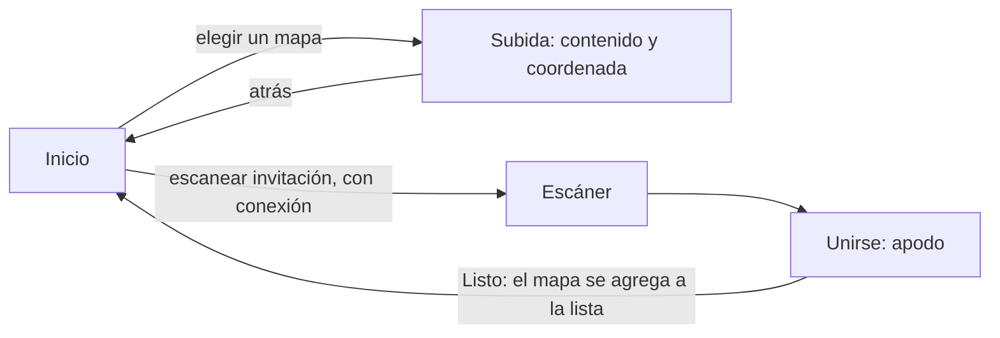
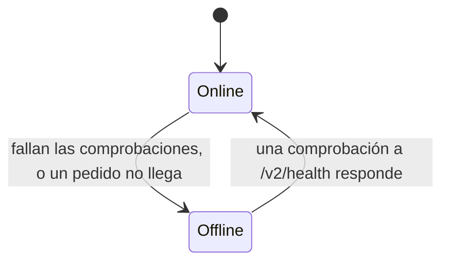
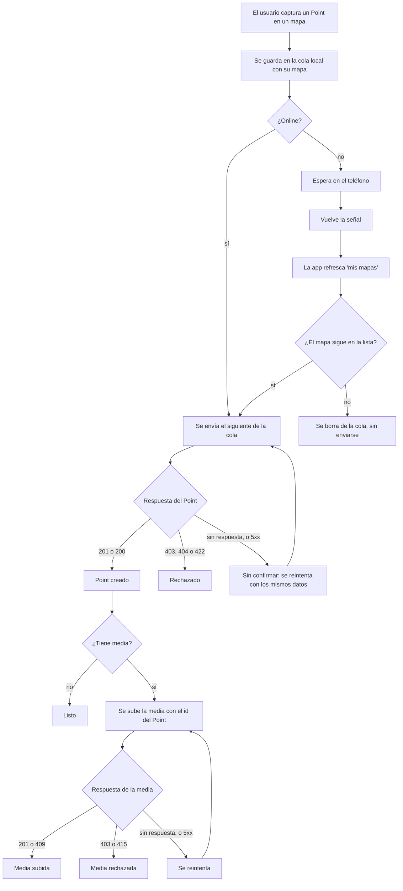
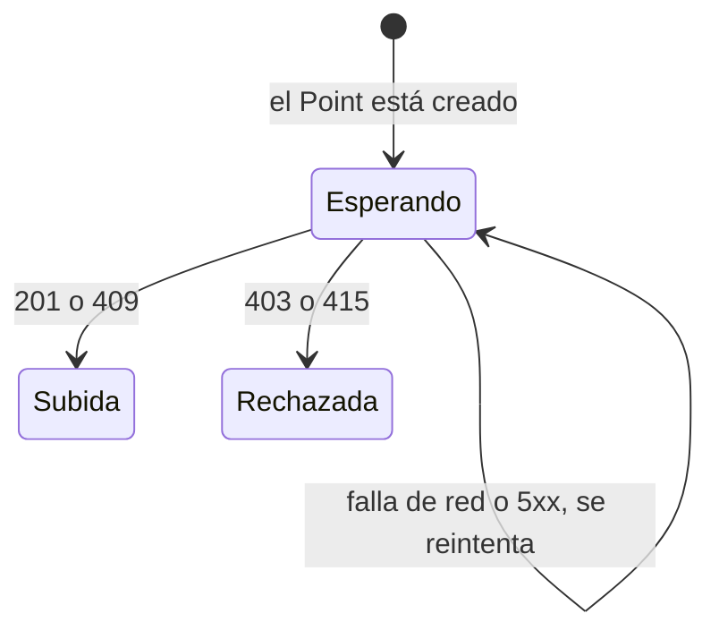

# Feature spec — Contribuciones sin conexión

`chatmap-app` captura Points y media en el campo, donde la conexión no es
confiable. Este documento define cómo la app detecta que no tiene conexión,
cómo captura mientras tanto, y cómo sube lo capturado cuando vuelve la señal.
Continúa [map_contributions.md](map_contributions.md), que define quién puede
contribuir y cómo se autoriza.

## Propósito

Permitir que una persona siga capturando Points y media sin conexión, sin
perder datos ni duplicarlos, y que se suban solos al mapa para el que se
capturaron cuando vuelva la señal.

## Alcance

**Dentro**

- Detectar si la app tiene acceso a nuestro servidor.
- Guardar y refrescar la lista de mapas en el teléfono.
- Capturar sin conexión para un mapa de esa lista, y subir lo capturado.
- Los estados que ve el usuario para cada Point y para su media.
- El historial de lo que el usuario subió a un mapa, leído del servidor.
- Que un reintento no cree un Point duplicado (el id se calcula de los datos).
- Los endpoints nuevos (`health`, "mis mapas", "mis Points de un mapa") y el
  cambio en la creación de Points.
- Las dos pantallas de la app y qué hace cada una.

**Fuera / diferido**

- **Garantizar que la copia esté al día antes de salir al campo.** La app
  refresca la lista cuando puede, pero no impide salir con una vieja: es
  responsabilidad del usuario.
- Un modo manual para forzar el estado offline.
- Refresco en segundo plano con la app cerrada, y refresco periódico con la app
  abierta.
- Consultar en lote el estado de los envíos (Decisión 16).
- Guardar en el teléfono el historial de lo ya creado (Decisión 12).
- Login con Hanko, moderación y control de abuso (ver
  [map_contributions.md](map_contributions.md)).

## Premisas

- **El servidor es la fuente de verdad.** Lo que hay en el teléfono es una
  copia: la lista de mapas y la cola de envío. El historial de lo ya creado
  **no se guarda**: se lee del servidor cada vez.
- **Unirse a un mapa necesita conexión**, porque el `join` es contra el
  servidor. Sin conexión, escanear una invitación debe avisarlo. Al unirse, el
  mapa se agrega a la lista guardada con la respuesta del `join`.
- **La lista de mapas se guarda en el teléfono** y puede estar desactualizada.
  Que la lista esté al día antes de salir es responsabilidad del usuario.
- El almacenamiento local es `expo-sqlite`.

## Pantallas



| Pantalla | Con conexión | Sin conexión |
|---|---|---|
| **Inicio** | La lista de mapas donde contribuís, refrescada, con la hora de su última actualización, y el botón para escanear una invitación | La última lista guardada, con la hora de su última actualización. Se puede elegir cualquier mapa de la lista. Escanear avisa que necesita conexión |
| **Subida** | La pantalla actual de contenido y coordenada, para el mapa elegido. Muestra el historial de lo que el usuario subió a ese mapa (leído del servidor) junto con lo que está en la cola, cada ítem con su estado. Todas las fotos se dibujan con la misma proporción, estén en la cola o en el historial | La misma, pero **sin historial**: solo se ve lo que está en la cola (sin confirmar y rechazado). Desde ahí se puede volver al Inicio y elegir otro mapa |

## Actualización de la lista de mapas

La lista se pide con "mis mapas" (ver [Contrato](#contrato)) y la respuesta
**reemplaza** la copia guardada. Se refresca:

- al abrir el Inicio con conexión,
- al volver la conexión, antes de enviar lo que haya en la cola,
- con un gesto de actualizar.

No hay refresco periódico. El Inicio muestra la hora de la última
actualización. Si el refresco falla, se conserva la última lista.

Un contribuyente siempre tiene al menos un mapa en la lista: unirse necesita
conexión y agrega el mapa a la copia local.

## Detección de conectividad

La app tiene dos estados, **online** y **offline**, y los decide un módulo
propio. Lo que importa no es si el teléfono tiene red, sino si **nuestro
servidor contesta**. Un teléfono puede estar conectado a una Wi-Fi sin salida a
internet: `expo-network` documenta que `isConnected` no implica internet
alcanzable, y que en iOS `isInternetReachable` es siempre igual a
`isConnected`.



| Fuente | Para qué sirve |
|---|---|
| Avisos del sistema (`expo-network`) | Disparan una comprobación inmediata cuando cambia la red |
| Comprobación periódica a `GET /v2/health`, con la app abierta | Detecta una red que no llega al servidor, aunque nadie esté haciendo nada |
| El resultado de cada pedido real | Una señal más, sin costo: si un pedido falla por la red, no hay que esperar la siguiente comprobación |

- La comprobación es **la misma en iOS y en Android**. Lo nativo de Android
  sirve de disparador, pero no decide, porque "internet validado" no significa
  que nuestro servidor conteste.
- Solo cuenta como "sin conexión" cuando el pedido **no llega**. Si el servidor
  contesta con un error (403, 404, 500), llegó, y la app sigue online.
- Con la app cerrada no hay detección.

**Parámetros.** Arrancan con estos valores estándar y se cambian con variables
de entorno de la app, que se fijan al construirla. Los nombres son provisorios.

| Parámetro | Valor inicial | Variable |
|---|---|---|
| Cada cuánto se comprueba, estando online | 30 s | `EXPO_PUBLIC_HEALTH_INTERVAL_MS` |
| Cuánto se espera la respuesta de una comprobación | 5 s | `EXPO_PUBLIC_HEALTH_TIMEOUT_MS` |
| Fallos seguidos para pasar a offline | 2 | `EXPO_PUBLIC_HEALTH_FAILURES_TO_OFFLINE` |
| Pausa entre comprobaciones estando offline | Empieza en 5 s, se duplica y llega a un máximo de 60 s | `EXPO_PUBLIC_HEALTH_RETRY_MIN_MS`, `EXPO_PUBLIC_HEALTH_RETRY_MAX_MS` |

Una sola comprobación que responde alcanza para volver a online. Los mismos
tiempos de pausa se usan para reintentar un envío que dio 5xx.

## Captura y subida



Un mismo mecanismo atiende los dos casos: todo Point pasa por la cola local,
con o sin conexión. Con conexión se envía enseguida. Sin conexión espera.

**Hay una sola cola, ordenada por la hora de captura**, sin separar por mapa.
Dentro de un mapa el orden de captura se respeta. Entre mapas no cambia el
resultado en el servidor, porque ningún Point depende de uno de otro mapa. Un
rechazo no frena la cola: se marca y se sigue con el siguiente. Una falla de red
sí la detiene, porque no hay nada que enviar hasta que vuelva.

**Qué guarda cada ítem de la cola en el teléfono**

| Dato | Detalle |
|---|---|
| Hora de captura | La que fijó la app cuando el usuario capturó, no la de envío ni la que ve el servidor al recibirlo |
| Coordenadas y mensaje | Lo que el usuario cargó |
| Media | El archivo local, hasta que se suba |
| Mapa | El mapa para el que se capturó |
| Estado del Point | Sin confirmar, creado o rechazado |
| Estado de la media | Solo si tiene: esperando, subida o rechazada |
| Id del Point en el servidor | Se completa cuando el servidor lo informa |

Un ítem sale de la cola cuando queda completo (Point creado y, si tiene, media
subida). Desde ahí el usuario lo ve en el historial que lee del servidor. Los
rechazados siguen en la cola, visibles con su motivo, hasta que el usuario los
descarte. Si un Point está a la vez en la cola y en el historial (por ejemplo,
creado y con la media pendiente), se muestra una sola vez, con los datos de la
cola, comparando por el id del servidor.

**La media se sube después del Point**, usando el id que devolvió el servidor,
porque la ruta de media (`POST /v2/points/{point_id}/media`) lo necesita. Un 409
de la ruta de media significa que el Point ya tiene una, y cuenta como subida.

## Estados de un Point

Cada Point tiene un estado propio. Si además lleva media, la media tiene otro,
y el usuario ve una marca por cada uno: la primera es la del Point y la segunda
es la de la media.




| Lo que ve el usuario | Significa | Cómo se llega |
|---|---|---|
| **Sin confirmar** (⏳) | El Point está solo en el teléfono, o se envió y no hubo respuesta | Al capturarlo. Se mantiene mientras no haya una respuesta definitiva |
| **Creado** (✓) | El servidor tiene el Point | Responde 201, o 200 al reintentar |
| **Rechazado** (✗) | El Point no se va a insertar y reintentar no cambia nada | El servidor responde 403 (te quitaron), 404 (el mapa ya no existe) o 422 (el Point es inválido) |
| **Media subida** (segunda marca ✓) | El servidor tiene la media del Point | Responde 201, o 409 si el Point ya tenía una |
| **Media rechazada** (segunda marca ✗) | La media no se va a subir | El servidor responde 403 (el Point no existe o no es tuyo) o 415 (tipo de archivo no soportado) |

Combinaciones que ve el usuario:

| Point sin media | Point con media |
|---|---|
| ⏳ sin confirmar | ⏳ sin confirmar (la media espera) |
| ✓ creado (final) | ✓ creado, media esperando |
| ✗ rechazado | ✓✓ Point y media entregados |
| | ✗ rechazado (la media no se intenta) |
| | ✓ ✗ creado, media rechazada |

"Sin confirmar" no dice "no fue creado": cuando no hay respuesta, la app **no
sabe** si el servidor lo guardó. "Creado" significa que el servidor lo tiene,
no que siga visible en el mapa.

Un Point que llegó al servidor y cuya respuesta se perdió, reintentado después
de que el dueño quitó al contribuyente, recibe 403 y queda como rechazado en la
cola aunque el servidor lo tenga. No se reconcilia: al refrescar la lista el mapa
ya no está, el ítem se borra de la cola, y el Point queda en el servidor (se
oculta, según la Decisión 17 de [map_contributions.md](map_contributions.md)).

## Casos y bordes

| Situación | Disparador | Resultado observable |
|---|---|---|
| Se pierde la conexión | Fallan las comprobaciones o un pedido no llega | La app pasa a offline. Lo que se captura sigue entrando a la cola, con su mapa |
| Elegir otro mapa sin conexión | El usuario vuelve al Inicio desde la Subida | Puede elegir cualquier mapa de la última lista guardada |
| Vuelve la conexión | Una comprobación a `/v2/health` responde | La app pasa a online, refresca la lista y envía lo que haya en la cola, en orden de hora de captura |
| Entrar a un mapa sin conexión | El usuario abre la Subida de un mapa estando offline | Ve solo lo que está en la cola. El historial aparece cuando haya conexión |
| Escanear sin conexión | El usuario abre el escáner | La app avisa que necesita conexión |
| La lista está vieja | Quitaron al usuario de un mapa mientras estaba sin conexión | Pudo capturar para ese mapa. Al volver la conexión, la lista refrescada ya no lo trae y esos Points se borran de la cola sin enviarse ni mostrarse |
| El mapa se renombró o se borró | Cambió en el servidor mientras la lista estaba vieja | La lista guardada muestra el nombre viejo. Si se borró, el envío responde 404 y pasa a "rechazado" |
| El refresco de la lista falla | Hay conexión, pero el pedido de "mis mapas" falla | Se conserva la última lista y se reintenta después |
| Respuesta perdida | Se envió, el servidor lo guardó, la respuesta no llegó | El ítem sigue "sin confirmar". Se reintenta con los mismos datos, el servidor calcula el mismo id y responde 200 con el mismo Point. Pasa a "creado" y no se duplica |
| Servidor caído, con red | `/v2/health` no responde | La app queda offline, igual que sin red |
| El servidor contesta con un 5xx | Error interno | Sigue online. El ítem queda "sin confirmar" y se reintenta con pausas |
| Quitaron al usuario entre el refresco y el envío | El servidor responde 403 | Los Points de ese mapa pasan a "rechazado" y **no se insertan**. En el próximo refresco el mapa ya no figura y se borran de la cola |
| Un mapa del que te quitaron | Se pide "mis mapas" | No aparece en la lista. No se puede entrar a su Subida, así que sus rechazados no se ven |
| Se cierra la app con Points en cola | El usuario la cierra o el sistema la mata | Los Points en cola y la lista de mapas persisten en `expo-sqlite` |
| Un Point con foto | Se captura con media | Se envía el Point (primera marca) y, con el id devuelto, se sube la foto (segunda marca). Si el Point se rechaza, la foto no se intenta |
| La foto se reintenta | La respuesta de la media se perdió y el servidor ya la tenía | Responde 409. Cuenta como subida |
| Un Point enviado cuya respuesta se perdió, visto en el historial | Se abre el historial antes de que el reintento responda | Puede verse dos veces: el ítem "sin confirmar" de la cola y el Point creado del historial. Al responder el reintento, el ítem pasa a creado y se muestra una sola vez. La app envía la cola antes de leer el historial para que pase lo menos posible |
| Se descarta un rechazado | El usuario lo descarta | Sale de la cola. No se vuelve a intentar |

## Contrato

**Nombres de ruta provisorios**, salvo `health`. La identidad de quien pregunta
va en la credencial, no en la ruta: ninguna ruta lleva `me`.

| Operación | Quién | Efecto observable |
|---|---|---|
| `GET /v2/health` | Sin sesión | Responde 200 con un cuerpo mínimo, por ejemplo `{"status": "ok"}`. **No consulta la base de datos**: dice que el servidor contesta, no que todo funcione. Se pide sin usar caché. No tiene relación con `GET /v1/status`, que es otra cosa y exige sesión |
| Listar mis mapas (`GET /v2/maps`) | Contribuyente: `Authorization: Contributor <secreto>` | Devuelve `{ "maps": [ { "map_id", "map_name", "nickname" } ] }` con los mapas donde el hash de ese secreto tiene un Contributor activo, en el orden en que se unió. Los nombres de los campos son los mismos que devuelve el `join`. No incluye los removidos, y un secreto que no es de nadie recibe una lista vacía con 200, no un error. Sin credencial de contribuyente, incluso con una sesión, responde 401. La respuesta reemplaza la lista guardada en el teléfono |
| `POST /v2/points` (existente, se modifica) | Dueño o contribuyente, según [map_contributions.md](map_contributions.md) | El pedido **ya no lleva `id`**: el servidor lo calcula a partir de los datos del Point. Responde **201** con el id si lo crea, y **200** con el mismo id si ya existía un Point con esos datos. La hora de captura es obligatoria. Esto reemplaza el comportamiento actual (el id lo manda la app, con 409 si es de otro) |
| Listar mis Points de un mapa (`GET /v2/maps/{map_id}/points`) | Contribuyente: `Authorization: Contributor <secreto>` | Devuelve los Points que **el contribuyente que firma el pedido** creó en ese mapa, sin los que el dueño ocultó (`removed`). Es el historial que dibuja la Subida: de cada Point trae id, hora de captura, coordenadas, mensaje y, si tiene, la media (id, `url`, tipo y tamaño). Responde 403 si el secreto no corresponde a un contribuyente activo de ese mapa, lo que incluye a los quitados y a un mapa borrado. Va de los más nuevos a los más viejos, de a 50 por página. La respuesta trae `next`, un cursor para pedir la página siguiente con el parámetro `cursor`, o `null` si no hay más. El cursor es opaco: la app lo devuelve tal cual, y uno inválido responde 422. La paginación es por clave `(hora de captura, id)`, no por desplazamiento, así que un Point nuevo mientras se pagina no repite ni se salta ninguno. `time` viaja en UTC. Qué devuelve esta ruta con la credencial del dueño queda para cuando se use |
| `GET /v2/media/{media_id}` (existente, se modifica) | Contribuyente: `Authorization: Contributor <secreto>`, además de lo que ya acepta | Deja leer la media de los Points **propios** del contribuyente, aunque el mapa sea privado. Antes solo leía el dueño, o cualquiera si el mapa es público, y eso sigue igual. Un contribuyente quitado, o que pide la media de otro contribuyente o del dueño en un mapa privado, recibe 404 |
| `POST /v2/points/{point_id}/media` | Dueño o contribuyente, según [map_contributions.md](map_contributions.md) | Se amplía para aceptar contribuyentes. Responde 201; 403 si el Point no existe o no es del remitente; 415 si el tipo de archivo no está soportado; 409 si el Point ya tiene una media (la app lo cuenta como subida); 503 si el almacenamiento no responde |

El historial depende de que `POST /v2/points` guarde `contributor_id` en los
Points de los contribuyentes: es lo que permite filtrar los propios. Para esa
consulta hay un índice parcial sobre `points (contributor_id, time, id)` donde
`contributor_id` no es nulo, así no indexa los Points del dueño, del bot ni de
las importaciones.

```json
{
  "points": [
    {
      "id": "9f2c…",
      "time": "2026-10-20T14:03:11Z",
      "latitude": -34.6037,
      "longitude": -58.3816,
      "message": null,
      "media": {
        "id": "b71e…",
        "url": "https://…/v2/media/b71e…",
        "content_type": "image/jpeg",
        "size": 482113
      }
    }
  ],
  "next": "…"
}
```

`media` es `null` si el Point no tiene. De ahí sale la marca que se dibuja: un
Point sin `media` es ✓, y con `media` es ✓✓.

**El id del Point se calcula de sus datos.** El servidor deriva el id con un hash
de quién lo envía, el mapa, la hora de captura, las coordenadas y el mensaje. Los
mismos datos dan siempre el mismo id. **La hora de captura es la que fijó la app
cuando el usuario capturó**, no la hora en que el servidor recibe el pedido: si
fuera la del servidor, un reintento tendría otra hora y daría otro id.

```text
Primer intento:  el servidor calcula el id X, inserta el Point con X, responde 201 y X
(la respuesta se pierde)
Reintento:       el servidor calcula el mismo X, la clave primaria ya existe → no inserta, responde 200 y X
```

- **No hay tabla ni encabezado extra.** La unicidad la garantiza la clave
  primaria de `points`, que ya existe.
- "Quién lo envía" es solo un ingrediente del cálculo: el contribuyente (su
  `contributor.id`) o el dueño (su `user.id`). El id no depende de que
  `contributor_id` esté completo. El historial sí lo usa, para filtrar los Points
  propios (ver Contrato).
- Dos personas con los mismos datos no comparten id, porque el remitente entra
  en el cálculo.
- **Lo capturado es inmutable**: un ítem de la cola no se edita, porque cambiar
  un dato cambiaría el id y un reintento duplicaría. La **hora de captura es
  obligatoria**.
- El reintento devuelve el id del Point original, así la cola lo recupera aunque
  se haya perdido la primera respuesta y puede subir la foto.
- Al insertar, un id que ya existe no se toca (`ON CONFLICT DO NOTHING`). El modo
  live, en cambio, actualiza la fila (`DO UPDATE`), porque reprocesa el mismo
  mensaje a propósito. Acá lo subido es inmutable.
- La forma exacta del hash (formato de cada dato, normalización de la hora a UTC,
  tratamiento de un mensaje vacío) se define al implementar. La condición es que
  sea determinista.

## Decisiones

1. **El servidor es la fuente de verdad, y lo local es una copia.**
   *Descartado:* que el teléfono sea la fuente y el servidor la reciba. Con una
   copia, una baja o un cambio del dueño se reflejan al refrescar.
2. **Almacenamiento local en `expo-sqlite`.** Sirve para la lista de mapas y la
   cola de envío, que necesitan orden y persistencia. *Descartado:* AsyncStorage
   (para una cola ordenada habría que sumar otra cosa) y `expo-secure-store`
   con un JSON (límites de tamaño en algunas versiones de iOS, y es una
   herramienta para secretos).
3. **Sin conexión se captura para un mapa de la lista guardada, y lo capturado se
   envía solo al volver la señal.** Desde la Subida se puede volver al Inicio y
   elegir otro mapa. La lista puede estar vieja, y eso es responsabilidad del
   usuario. *Descartado:* capturar borradores sin mapa y elegir el destino al
   volver la señal (agrega una pantalla de asignación, grupos y selección de
   subconjuntos), y un modo offline manual con descarga previa. *Costo
   aceptado:* quien capturó para un mapa del que ya lo habían quitado pierde
   esos Points.
4. **Dos estados, online y offline, decididos por una comprobación a nuestro
   servidor en las dos plataformas.** Los avisos del sistema son el disparador,
   y cada pedido real aporta una señal. *Descartado:* confiar solo en el estado
   de red del sistema (en iOS no distingue una Wi-Fi sin salida), solo en el
   resultado de los pedidos (no avisa cuándo volvió la conexión), y usar lo
   nativo en Android y el ping solo en iOS (responden preguntas distintas y hay
   dos caminos que mantener).
5. **No hay modo manual de forzar offline.** Existía para descargar antes de
   salir, y con la decisión 3 ya no hay nada que preparar. Se puede agregar
   después sin cambiar el resto.
6. **El id del Point lo calcula el servidor a partir de los datos del Point.**
   Un reintento no duplica aunque la respuesta se haya perdido, porque da el
   mismo id y la clave primaria lo rechaza. Vale también para la ruta del dueño,
   que deja de recibir el id de la app: hoy nadie la usa, así que el cambio no
   rompe nada. Tiene precedente en D-003 de [live_mode.md](live_mode.md), donde
   el id del modo live se deriva de la hora del mensaje de WhatsApp. Acá es un
   hash de remitente, mapa, hora de captura, coordenadas y mensaje, porque
   `points.id` es la clave primaria de toda la tabla y usar solo la hora, como el
   live (con resolución de segundo), chocaría entre remitentes. La hora es la que
   fijó la app al capturar, no la que ve el servidor. *Descartado:* copiar el id
   del modo live tal cual; que el id lo genere la app (el Point no debe depender
   de la sincronización);
   una clave de idempotencia con una tabla aparte (agrega una tabla que crece
   con cada Point, un encabezado y un vencimiento); una regla única solo por
   coordenadas (descartaría Points legítimos hechos en el mismo lugar); una
   restricción única sobre columnas de `points` (no cubre al dueño, que tiene
   `contributor_id` vacío, igual que el bot y las importaciones); y preguntar el
   estado después (la consulta no cierra la carrera entre el pedido original y
   el reintento). *Riesgo aceptado:* dos Points con exactamente los mismos datos
   se fusionan en uno. No preocupa, porque coinciden remitente, mapa, hora de
   captura, coordenadas y mensaje.
7. **Tres estados para el Point (sin confirmar, creado, rechazado) y otros tres
   para su media (esperando, subida, rechazada), con una marca por cada uno.**
   "Sin confirmar" junta "en la cola" y "enviado sin respuesta", porque el
   usuario no puede hacer nada distinto en cada caso. Los rechazados quedan
   visibles con su motivo hasta que el usuario los descarte. Un fallo de red o un
   5xx no es un rechazo. Una media que responde 409 cuenta como subida.
   *Descartado:* "no fue creado" como texto del primer estado, porque sin
   respuesta la app no puede afirmarlo; y mostrar "creado" solo cuando el Point y
   la media estén confirmados (el Point ya existe, y la media es un segundo pedido
   que puede fallar por separado).
8. **Si te quitaron, los Points en cola de ese mapa no se insertan.** Resuelve la
   pregunta 4 de [map_contributions.md](map_contributions.md). Al volver la
   conexión, la app refresca la lista antes de enviar y borra de la cola, sin
   enviarlos ni mostrarlos, los Points de los mapas que ya no figuran: ese mapa
   no es accesible, así que sus rechazados no se podrían ver. Si la baja ocurre
   entre el refresco y el envío, el servidor responde 403, el Point queda
   rechazado y se borra en el próximo refresco. *Costo aceptado:* quien capturó
   antes de la baja y subió después pierde esos Points.
9. **Unirse necesita conexión.** El `join` es contra el servidor.
10. **La lista de mapas se guarda en el teléfono como copia, con la hora de su
    última actualización.** Es lo que permite elegir un mapa sin conexión. Se
    invierte una decisión anterior, que era no guardarla y pedirla al volver la
    señal. *Descartado:* no guardarla.
11. **La lista se refresca al abrir el Inicio con conexión, al volver la
    conexión y con un gesto de actualizar.** No hay refresco periódico, porque
    con la app abierta la lista casi no cambia. *Descartado:* refrescarla
    también cada cierto tiempo.
12. **El historial de lo ya creado se lee del servidor y no se guarda en el
    teléfono.** El usuario entra a un mapa y ve lo que subió, traído con "mis
    Points de un mapa". En el teléfono quedan solo la lista de mapas y la cola
    (sin confirmar y rechazados). Sin conexión no hay historial. *Descartado:*
    guardar una copia del historial (habría que decidir cuánto se conserva y
    cómo se reconcilia con el servidor). *Costo aceptado:* sin conexión no se ve
    lo ya subido.
13. **Una sola cola, ordenada por la hora de captura.** No se separa por mapa. La
    hora de captura es la que fija la app, y es la que entra en el id. *Descartado:*
    una cola por mapa (no cambia el resultado y agrega una regla).
14. **`/v2/health` no consulta la base de datos.** Una falla de la base no deja a
    toda la flota "offline", y el endpoint responde solo que el servidor contesta.
15. **Los parámetros de la detección tienen valores estándar y se cambian con
    variables de entorno de la app.** Ver la tabla de parámetros en Detección de
    conectividad.
16. **No hay consulta de estado en lote.** Con el id calculado por el servidor, la
    app no lo conoce hasta la primera respuesta, así que no podría preguntar por
    él. Alcanza con reintentar con los mismos datos.
17. **El historial se pide de a 50, de los más nuevos a los más viejos, y las
    fotos se dibujan todas con la misma proporción.** La respuesta trae lo
    necesario para dibujar cada Point en la Subida: coordenadas para el mosaico
    del mapa y, si hay media, su `url`. Por eso la tabla `media` no guarda ancho
    ni alto. *Descartado:* que la app mande las dimensiones al subir (agrega una
    migración y dos campos para algo que solo afecta cómo se dibuja), calcularlas
    en el servidor (suma una librería de imágenes y no sirve para audio), y
    devolver todo el historial de una vez (crece sin límite).

## Preguntas abiertas

Las marcadas como **Resuelta** indican dónde quedó la decisión.

1. **Resuelta** (Decisión 3): lo capturado queda en el mapa para el que se
   capturó.
2. **Resuelta** (Decisión 3): no hay asignación de destino al volver la señal.
3. **Resuelta** (Decisión 7): "sin confirmar" es un único estado.
4. **Resuelta** (Decisión 7): los rechazados quedan visibles hasta que el usuario
   los descarte.
5. **Resuelta** (Decisión 6): la ruta del dueño para crear Points pasa al
   mecanismo nuevo.
6. **Resuelta** (Decisión 7): un Point con foto tiene una marca por el Point y
   otra por la media.
7. **Resuelta** (Decisión 14): `/v2/health` no toca la base de datos.
8. **Resuelta** (Decisión 15): valores estándar con variables de entorno.
9. **Resuelta** (Decisión 12): los Points ya creados no se guardan en el
   teléfono.
10. **Resuelta** (Decisión 7): una media que responde 409 cuenta como subida.
11. **Resuelta** (sección Estados de un Point): un Point que llegó, reintentado
    después de la baja, queda como rechazado en la cola aunque el servidor lo
    tenga, y no se reconcilia.
12. **Resuelta** (Decisión 16): no hay consulta de estado en lote.
13. **Resuelta** (Decisión 11): la lista se refresca al abrir el Inicio con
    conexión, al volver la conexión y con un gesto de actualizar.
14. **Resuelta** (Decisión 13): una sola cola por hora de captura.
15. **Resuelta** (Decisión 6): ya no hay clave de idempotencia ni encabezado.
16. **Resuelta** (Decisión 8): los Points en cola de un mapa que sale de la lista
    se borran, porque su Subida no es accesible.
17. **Resuelta** (Decisión 17): la forma de "mis Points de un mapa".
