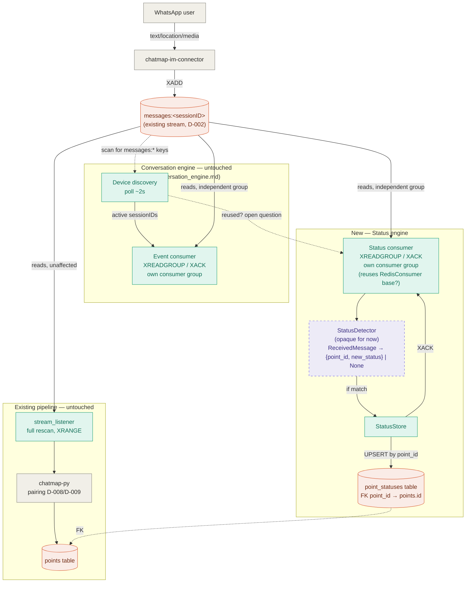

# Status engine — draft diagram

Point status (e.g. a Point as "gate"/"step", enabled or disabled),
computed from the same message stream, as a new engine parallel to
[conversation_engine.md](./conversation_engine.md).

